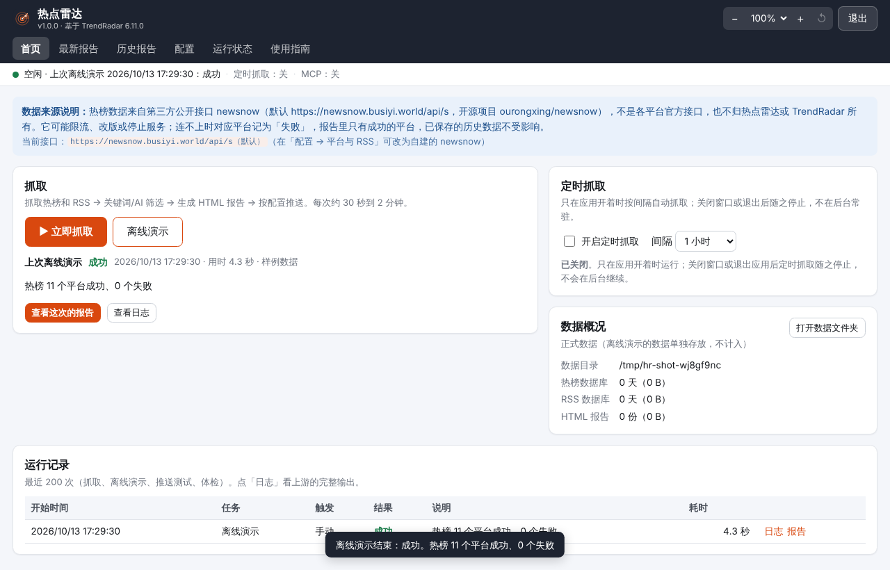
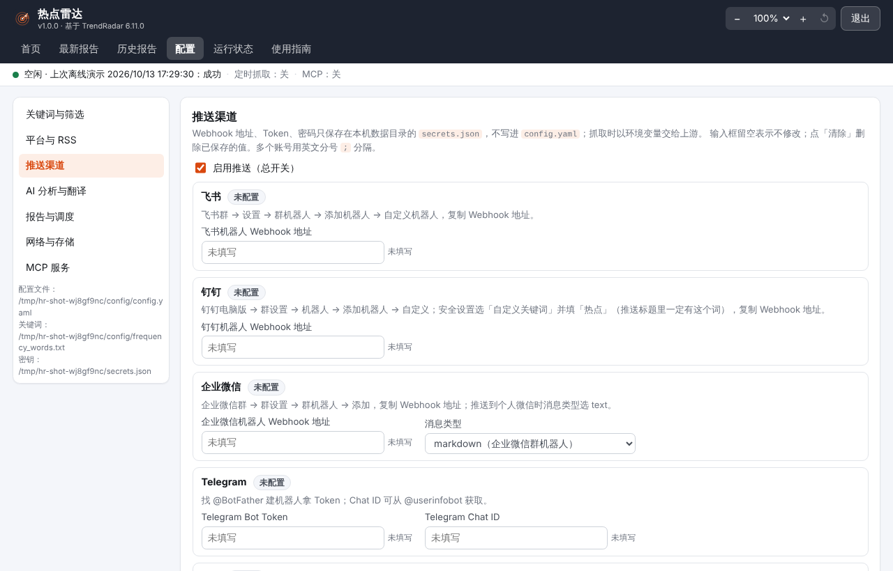
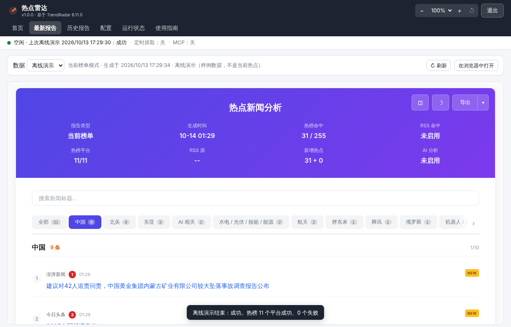
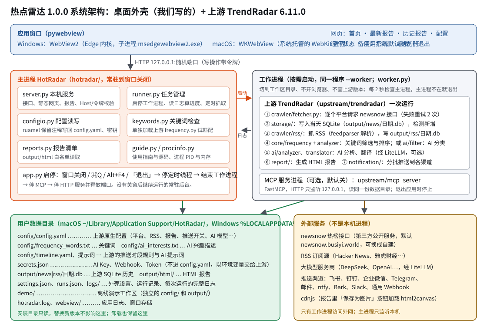

本篇就是应用里主导航「使用指南」的主体，没打开应用也能读懂。返回 [项目阅读入口](<00 项目阅读入口.md>)。
热点雷达 1.0.0 = 我们写的桌面外壳 + 上游开源项目 TrendRadar 6.11.0（GPL-3.0）。



## 1. 怎样开始和结束

### 安装和首次打开

| | macOS（Apple Silicon，M 系列芯片） | Windows 10/11（x64） |
| --- | --- | --- |
| 安装包 | `HotRadar-1.0.0-macOS-arm64.dmg` | `HotRadar-Setup-1.0.0-x64.exe`；不想安装可用 `HotRadar-1.0.0-windows-x64.zip` |
| 安装 | 打开 dmg，把「热点雷达」拖进「应用程序」 | 双击安装程序 → 同意 GPL-3.0 许可 → 选目录（默认 `%LOCALAPPDATA%\Programs\HotRadar\`）→ 安装。不需要管理员权限，会建开始菜单和桌面快捷方式。免安装版：解压后双击 `HotRadar\HotRadar.exe` |
| 首次打开 | 应用没有 Apple 签名，第一次在「应用程序」里**右键 →「打开」**；或「系统设置 → 隐私与安全性」点「仍要打开」 | SmartScreen 提示「已保护你的电脑」时点「更多信息 → 仍要运行」；杀毒软件拦截见第 5 节 |
| 窗口组件 | 系统自带 WKWebView，不用另装 | 用系统的 Microsoft Edge WebView2（Windows 11 自带，Windows 10 一般已随 Edge 安装）；缺少时自动改用默认浏览器打开 |
| 卸载 | 把「热点雷达」拖进废纸篓 | 「设置 → 应用」或开始菜单「卸载热点雷达」 |
| 卸载后数据 | 保留在 `~/Library/Application Support/HotRadar/`，要彻底删除就手动删这个文件夹 | 保留在 `%LOCALAPPDATA%\HotRadar\`，同左 |

不需要装 Python，也不需要命令行。

### 首次准备

1. 打开后先看首页顶部的「数据来源说明」：热榜来自第三方 newsnow 公开接口（见第 3 节）。
2. 点「▶ 立即抓取」试一次。能联网访问 newsnow 时，30 秒到 1 分钟出结果；连不上时每个平台会重试，2–3 分钟后报「失败」（见第 5 节）。
3. 网络不通或只想先看看效果：点「离线演示」，用上游仓库附带的 2025-12-27 真实热榜样例跑一遍全流程，几秒出报告。演示数据单独存放，不混进正式数据。
4. 按自己的关注点改关键词（第 2 节「配置关键词」），需要推送就填飞书/钉钉/企业微信地址，需要 AI 分析就填 AI Key。这些都**不是必需的**：不填推送就只生成报告，不填 Key 就跳过 AI。

不需要注册或登录任何账号。

### 打开后发生什么

1. 主进程启动本机服务，只监听 `127.0.0.1` 的一个随机端口，外部电脑访问不到；第一次运行时把上游默认配置复制到数据目录。
2. 应用窗口打开首页。
3. 如果之前开着「定时抓取」，从现在起按间隔抓取（窗口开着才抓）。

### 关闭、退出和最小化

| 操作 | macOS | Windows | 结果 |
| --- | --- | --- | --- |
| 关闭窗口 | 红色关闭按钮 | 右上角 × | **退出应用**：停止定时抓取，结束正在运行的抓取工作进程和 MCP 服务进程，停止本机服务并释放端口 |
| 退出命令 | ⌘Q、菜单「退出」、程序坞右键「退出」 | Alt+F4、任务栏右键「关闭窗口」 | 同上 |
| 界面右上角「退出」按钮 | 有 | 有 | 同上；有任务在跑时会先确认 |
| 最小化、隐藏、切到别的应用 | 黄色按钮、⌘H | 最小化按钮 | **应用和定时抓取继续运行**，抓取照常进行 |

- 热点雷达只有一个窗口，关掉它就是退出。
- **没有「关窗后继续在后台抓取」的常驻模式**，也没有系统托盘常驻。定时抓取只在窗口开着时进行；想 7×24 自动抓取需要电脑一直开着热点雷达窗口（可以最小化）。需要关窗后仍常驻的话，属于要单独约定的功能，目前**未实现**。
- 正常退出时，主进程先结束工作进程并确认它们已退出，再停服务。退出不会删除任何配置、密钥或数据。
- **异常收尾**：主进程崩溃或被强制结束时，工作进程（抓取、MCP 服务）每 2 秒检查一次主进程是否还在（按 PID 和启动时间核对），发现不在就在 2 秒内自行退出，不会长期遗留。本机服务是主进程里的线程，随主进程一起结束。
- 用默认浏览器打开的情况（窗口组件不可用时）：关掉浏览器标签页 3 分钟后应用自动退出。
- 同时打开两个热点雷达（例如双击了两次）会各开一个窗口；两边共用同一份数据，同一时间只允许一边在抓取，另一边点抓取会提示等待。

## 2. 怎样完成主要任务

### 各页面

| 页面 | 用途 | 常用操作 |
| --- | --- | --- |
| 首页 | 抓取、看进度和结果、定时抓取、运行记录、数据概况 | 「▶ 立即抓取」「离线演示」「■ 停止」；勾选「开启定时抓取」并选间隔；运行记录里点「日志」「报告」 |
| 最新报告 | 显示上游生成的最新一份 HTML 报告 | 「数据」切换正式数据/离线演示；「↻ 刷新」；「在浏览器中打开」 |
| 历史报告 | 按日期列出每次运行的报告快照 | 点左边一份，右边显示；也能在浏览器中打开 |
| 配置 | 关键词与筛选、平台与 RSS、推送渠道、AI 分析与翻译、报告与调度、网络与存储、MCP 服务 | 每个分类有自己的「保存」按钮，保存后**下一次抓取生效** |
| 运行状态 | 本应用每个进程的 PID 和内存、后台任务 | 「立即刷新」；页面每 3 秒自动刷新 |
| 使用指南 | 本文档和其余全部文档、源码查看与下载、附件 | 左边目录切换；「源码」两组；「下载全部源码（zip）」 |

顶部右侧：缩放控件（第 8 节）和「退出」。顶部第二行是栏目。状态条显示当前任务、定时抓取和 MCP 状态。

### 最常用的顺序

1. 「配置 → 关键词与筛选」写好关注的词，点「检查语法」「试匹配」确认，「保存关键词」。
2. 「首页 → ▶ 立即抓取」，看进度条和平台小标签（绿色 ✓ 成功、红色 ✗ 失败，鼠标停在上面看原因）。
3. 结束后点「查看这次的报告」，或到「最新报告」。
4. 想定时看：首页勾「开启定时抓取」，选间隔（15 分钟到 12 小时），保持窗口开着（可最小化）。
5. 想推送到手机：「配置 → 推送渠道」填地址 → 保存 →「发送测试推送」。

### 抓取一次做了什么（结果在哪）

一次「立即抓取」等于上游 TrendRadar 跑一遍：

1. 逐个平台请求 newsnow 接口取当前热榜（默认 11 个平台，平台之间间隔约 2 秒）；
2. 写入当天的数据库 `output/news/日期.db`，并标出本次新出现的标题；
3. 抓 RSS（默认 Hacker News、雅虎财经），写入 `output/rss/日期.db`；
4. 按关键词（或 AI）筛选、按排名/出现次数/热度加权排序；
5. 有 AI Key 且开启时，生成 AI 分析、翻译；
6. 生成 HTML 报告：`output/html/日期/时-分.html`，并更新 `output/html/latest/模式.html`；
7. 配置了推送且开启时，按渠道分批发送。

### 配置关键词（frequency_words.txt）

在「配置 → 关键词与筛选」编辑，写法就是上游的 `frequency_words.txt`：

| 写法 | 含义 |
| --- | --- |
| `华为` | 普通词：标题包含它就命中 |
| 空行 | 分隔词组；同一词组里多个普通词是「或」 |
| `[华为]`（词组第一行） | 这一组的显示名称 |
| `+发布会` | 必须词：这一组里所有必须词都要出现 |
| `!水果` | 过滤词：标题含它就不要。**注意**：上游实现里过滤词对**所有词组**生效，不只本组（配置文件注释说「仅限当前词组」，与代码不一致，以代码为准） |
| `@5` | 这一组最多显示 5 条 |
| `/华为\|鸿蒙/ => 华为` | 正则表达式（忽略大小写），`=>` 后是显示名称；`\b` 表示英文单词边界，如 `/\bAI\b/` |
| `[GLOBAL_FILTER]` 后面的词 | 全局过滤词，优先级最高 |
| `[WORD_GROUPS]` 后面 | 词组区 |
| `# …` | 注释 |

例子：只关注华为、比亚迪，排除标题党：

```text
[GLOBAL_FILTER]
震惊
/太可怕|竟然/

[WORD_GROUPS]

[华为]
华为
鸿蒙
任正非

[比亚迪]
比亚迪
王传福
!二手车
@10
```

- 「检查语法」用上游的解析函数解析，右边列出每个词组、过滤词；正则写错会出现中文警告（该行按普通词处理）。
- 「试匹配」每行一个标题，看会不会被选中、命中哪个词组、被哪个过滤词排除。
- 「＋ 添加一个词组」用表单生成一段加到文件末尾，再检查、保存。
- 一个词组都没有时，上游会显示**全部**新闻。
- 保存时旧文件备份成 `frequency_words.txt.bak`。

**AI 智能筛选**（可选）：筛选方式改成「AI 智能筛选」后，不再看关键词文件，而是把「AI 兴趣描述」（`ai_interests.txt`，用自然语言写关注方向，越靠前越重要）交给大模型：第一次运行时让模型提取标签，之后每条标题由模型打相关度分，低于「最低相关度」（默认 0.7）的不要。每次运行都消耗 token，需要先填 AI Key。

### 接飞书、钉钉、企业微信推送



在「配置 → 推送渠道」：先把「启用推送（总开关）」打开，再填对应渠道，点「保存推送设置」，最后点「发送测试推送」，到首页运行记录看结果。

| 渠道 | 怎么拿地址 | 填到哪 |
| --- | --- | --- |
| 飞书 | 飞书群 → 右上角「更多 → 设置」→「群机器人」→「添加机器人」→「自定义机器人」→ 起名 → 复制 Webhook 地址（形如 `https://open.feishu.cn/open-apis/bot/v2/hook/…`）。安全设置不要开「签名校验」（上游不支持签名） | 飞书机器人 Webhook 地址 |
| 钉钉 | **钉钉电脑版**进群 → 群设置 →「机器人」→「添加机器人」→「自定义」→ 安全设置选「**自定义关键词**」，填 `热点`（上游推送标题是「TrendRadar 热点分析报告 - …」，一定含这个词）→ 同意条款 → 复制 Webhook 地址。手机版只能收消息，不能建机器人 | 钉钉机器人 Webhook 地址 |
| 企业微信 | 企业微信群 → 右上角「…」→「消息推送」→「添加」→ 起名 → 复制 Webhook 地址 | 企业微信机器人 Webhook 地址；消息类型选 `markdown` |
| 个人微信 | 用企业微信的「微信插件」把企业微信应用关联到个人微信（上游 README 有图示），Webhook 地址同上 | 同上，消息类型改成 `text`（纯文本，没有格式） |
| 其他 | Telegram（Bot Token + Chat ID）、邮件（发件邮箱 + **授权码** + 收件邮箱）、ntfy、Bark、Slack、通用 Webhook | 各自的格子 |

- 多个群：同一格里用英文分号 `;` 分隔多个地址，每个渠道最多 3 个。
- 地址、Token、密码**只保存在本机数据目录的 `secrets.json`**，不写进 `config.yaml`；界面上只显示「已填写（末尾 …abcd）」。输入框留空表示不修改，「清除」删除已保存的值。抓取时它们以环境变量（`FEISHU_WEBHOOK_URL`、`DINGTALK_WEBHOOK_URL`、`WEWORK_WEBHOOK_URL` 等，上游原生支持）交给工作进程。
- 推送什么时候发：每次抓取结束后按「报告模式」发（第 4 节）；「增量监控」模式下没有新匹配就不发。启用「上游的推送时段调度」后，还要看时段规则（「配置 → 报告与调度」）。
- 离线演示**从不推送**。

### 填 AI Key（AI 分析、翻译、AI 筛选共用）

「配置 → AI 分析与翻译」：

1. **模型**写成「提供商/模型名」，例如 `deepseek/deepseek-v4-flash`（上游默认，便宜）、`openai/gpt-4o`、`gemini/gemini-2.5-flash`、`anthropic/claude-sonnet-4-20250514`。上游通过 LiteLLM 调用，完整列表见 LiteLLM 文档。
2. **API Key**：到对应服务商网站申请，粘贴进来，保存（同样只存在 `secrets.json`）。
3. **接口地址**：用国内中转站或自建服务时才填（如 `https://…/v1`），同时把模型名改成 `openai/模型名`。
4. 打开「每次运行生成 AI 分析」或「翻译标题」，保存。
5. 点「环境体检」（上游 `--doctor`），在首页运行记录的日志里看 AI 能否连通。

没填 Key 时 AI 部分自动跳过（日志里有「未配置 AI API Key」），抓取和报告照常。费用按服务商计费，见第 4 节「成本」。

### 其他配置

- **平台与 RSS**：勾选/取消平台；改显示名称；「＋ 添加平台」要填 newsnow 支持的平台 ID（见 newsnow 源码 `server/sources` 目录里的文件名）和校验域名（例如 `36kr.com`；返回的链接不是 https 或不属于这个域名，整个平台的数据会被丢弃，防篡改）。接口地址留空用默认 newsnow，自建 newsnow 时填 `https://你的域名/api/s`。RSS 源填名称、英文 ID、订阅地址。
- **报告与调度**：报告模式、分组方式、报告里显示哪些区域、独立展示区（某些平台完整列出不过滤）、上游的推送时段调度预设。
- **网络与存储**：请求间隔、代理（公司网络或访问海外 RSS 时用）、数据保留天数（默认 0 = 永久）、另存 TXT 快照、时区（默认 `Asia/Shanghai`，报告里的时间按这个时区）。
- **MCP 服务**：见第 6 节。
- 所有界面上改的东西都写回上游原生的配置文件（保留文件里的注释），高级用户也可以直接用文本编辑器改数据目录里的 `config/config.yaml`，下次抓取生效。改坏了可用同目录的 `config.yaml.bak` 恢复。

## 3. 数据从哪来、何时更新

### 来源

| 数据 | 来源 | 说明 |
| --- | --- | --- |
| 热榜 | **newsnow 公开接口**，默认 `https://newsnow.busiyi.world/api/s?id=平台ID&latest` | newsnow 是开源项目（ourongxing/newsnow），这个地址是它的作者公开运营的实例，**不是**微博、知乎等平台的官方接口，也不归 TrendRadar 或热点雷达所有。TrendRadar 作者说明「经联系，作者表示无需担心服务器压力，但这是基于他的善意和信任」。它可能限流、改版、停止服务，或在某些网络下访问不到。可以自建 newsnow 并在「平台与 RSS」里改接口地址 |
| 默认平台（11 个） | 今日头条、百度热搜、华尔街见闻、澎湃新闻、bilibili 热搜、财联社热门、凤凰网、贴吧、微博、抖音、知乎 | 每个平台一次返回当时榜单上的若干条（样例数据里 10–30 条不等，以 newsnow 返回为准） |
| RSS | 各订阅源原站（默认 Hacker News `hnrss.org`、雅虎财经） | feedparser 解析；海外源在国内可能需要代理 |
| AI 分析/翻译 | 你配置的大模型服务商 | 只有开启且填了 Key 才调用 |

### 何时更新

- **手动**：首页「▶ 立即抓取」。
- **定时**：首页「开启定时抓取」，间隔 15/30 分钟、1/2/3/6/12 小时；只在应用开着时进行。到点时如果别的任务正在跑，一分钟后再看。
- **没有**任何关窗后的后台更新。
- 上游的「推送时段调度」（timeline.yaml）只决定每次运行时**是否推送、是否做 AI 分析、用哪种报告模式**，不会自己触发抓取。

### 存在哪、留多久

| 内容 | 位置（数据目录下） | 保留 |
| --- | --- | --- |
| 热榜历史 | `output/news/YYYY-MM-DD.db`（每天一个 SQLite：标题、平台、每次抓取的排名轨迹、首次/最后出现时间） | 默认永久；「网络与存储 → 数据保留天数」可改 |
| RSS 历史 | `output/rss/YYYY-MM-DD.db` | 同上 |
| 报告 | `output/html/YYYY-MM-DD/HH-MM.html`（快照）、`output/html/latest/当前榜单等.html` | 同上 |
| 运行记录、日志 | `runs.json`（最近 200 次）、`logs/run-时间.log`（最近 60 份） | 自动轮换 |
| 离线演示 | `demo/` 下独立的一套 | 不影响正式数据 |

### 缺失、零、失败的区别

- **平台失败**：首页平台标签红色 ✗，原因写成中文（网络或代理拒绝连接、域名解析失败、请求超时、证书失败、newsnow 返回错误等），原始报错在日志里。失败的平台本次没有数据，报告里「热榜平台」显示成功数/总数（例如 9/11）。
- **全部失败**：通常是连不上 newsnow，本次**不生成新报告**（上游会打印「数据一致性检查失败」），运行记录结果为「失败」；之前的报告和历史数据都还在。
- **成功但 0 条命中**：平台都取到了，但没有标题命中你的关键词——报告里「热榜命中 0 / N」。这不是失败。
- **增量模式下没有新增**：不推送，报告照常生成。
- **未启用 / 未配置**：RSS 关掉、AI 没 Key、推送没填——报告里对应位置显示「未启用」或不出现，不是错误。
- **时间**：报告里的时间按配置的时区（默认北京时间）；首页运行记录的时间按本机时区。

## 4. 结果如何理解



- **报告头部**：报告类型（当前榜单/全天汇总/增量）、生成时间、热榜命中（命中条数 / 抓到的总条数）、RSS 命中、热榜平台（成功/总数）、新增热点、AI 分析状态。
- **关键词分组**：每个词组一节，组名后是条数；每条标题前是来源平台、排名（数字越小越靠前，红色是进入「排名高亮阈值」前几名）、出现时间段和次数；「NEW」表示本次新出现。
- **排序**：上游按排名（权重 0.6）、出现次数（0.3）、热度（0.1）加权，可在 `config.yaml` 的 `advanced.weight` 改。
- **三种报告模式**：
  - 当前榜单（current，默认）：只列现在还在榜上的匹配标题，持续在榜的每次都出现；
  - 全天汇总（daily）：当天所有匹配过的标题，包括已下榜的；
  - 增量监控（incremental）：只列这次新出现的，没有新增就不推送。
- **AI 分析**（开启后）：模型按上游提示词（`config/ai_analysis_prompt.txt`）输出五块——核心热点态势、舆论风向争议（情绪光谱）、异动与弱信号、RSS 深度洞察、研判策略建议，外加独立展示区概括。这是**对整批热点的文字研判**，不是逐条打分；**热点雷达和上游都没有逐条新闻的正/负面情感分数**（这一点和舆情监控系统不同，见第 04 篇）。
- **报告里的按钮**：⊡ 宽屏、☽ 深色、「导出」（保存为图片需要从 cdnjs 加载 html2canvas，离线时不可用；复制为 Markdown 可用）。
- **适用范围与已知限制**：
  - 热榜是「榜单上的标题」，不是全网舆情，也没有正文、评论、转发数；适合「今天大家在关注什么」，不适合「某公司的全部报道」。
  - 依赖第三方 newsnow，它挂了热榜就取不到。
  - ntfy 推送的标题是英文（上游为避免 HTTP 头编码问题固定用英文标题），正文是中文。
  - 同一新闻在不同平台标题不同，会算成不同条目。
  - 已实现但**未在用户电脑上验证**：真实联网抓取、各推送渠道实际送达、AI 实际调用（见文末「验收情况」）。

## 5. 出了问题怎么办

| 现象 | 检查路径 |
| --- | --- |
| 全部平台失败，原因是「网络或代理拒绝连接」「域名解析失败」「连不上服务器」 | 先用浏览器打开 `https://newsnow.busiyi.world/` 看能否访问 → 公司网络/防火墙可能拦截：在「网络与存储」填代理并勾「热榜走代理」→ 仍不行就是 newsnow 暂时不可用，等一会儿或自建 newsnow。先用「离线演示」确认应用本身没问题 |
| 个别平台失败，原因是「返回错误状态」「数据状态异常」 | newsnow 对该平台临时出错，下次通常恢复；长期失败可能是平台 ID 不再支持 |
| 平台被丢弃，日志有「安全警告…未通过域名安全校验」 | 返回的链接域名和「校验域名」不一致；确认接口地址可信，或改对校验域名 |
| 推送没收到 | 「启用推送」总开关是否打开 →「发送测试推送」→ 首页运行记录看日志：钉钉报关键词错误就是没填「热点」；飞书报签名错误就关掉签名校验；增量模式没有新增不会推送；启用了时段调度要看当前时段是否允许推送 |
| AI 分析没有出现 | 日志搜「[AI]」：未配置 Key / 模型格式不对（要「提供商/模型名」）/ 余额不足或超时 →「环境体检」 |
| 关键词好像没生效 | 「检查语法」看有没有警告 →「试匹配」→ 记得点「保存关键词」，下一次抓取才生效 |
| 窗口打不开，变成浏览器打开 | Windows：WebView2 运行库缺失或损坏，到微软官网装「Microsoft Edge WebView2 Runtime」；功能不受影响 |
| macOS 提示「无法打开，因为无法验证开发者」 | 第 1 节：右键 → 打开，或系统设置里「仍要打开」 |
| Windows 杀毒软件删了文件或拦截 | 打包程序没有代码签名，个别杀毒软件会误报：把安装目录 `%LOCALAPPDATA%\Programs\HotRadar\` 加入信任后重装 |
| 数据没更新 | 首页看上次运行时间和结果；定时抓取只在窗口开着时进行；运行状态页看有没有工作进程 |
| 想从头再来 | 退出后把数据目录改名备份，再打开会重新生成默认配置 |

应用日志：数据目录下 `hotradar.log`；每次运行的完整输出：`logs/`（首页运行记录点「日志」也能看）。

## 6. 软件框架、系统架构与源码

热点雷达分两层：**上游 TrendRadar**（抓取、存储、筛选、AI、报告、推送、MCP，Python）原样放在 `upstream/`，只改了 6 处（见 UPSTREAM.md）；**我们的外壳** `hotradar/` 负责窗口、本机服务、配置界面、任务管理和打包。



- 窗口（pywebview）→ 本机服务（主进程，127.0.0.1）→ 需要时启动**工作进程**（同一个程序加 `--worker` 参数）运行上游的一次抓取或 MCP 服务 → 读写用户数据目录 → 访问 newsnow、RSS、大模型、推送渠道。
- 为什么用工作进程：上游按「当前目录下的 config/ 和 output/」工作、会加载 LiteLLM 等大依赖（工作进程峰值约 150 MiB，见第 7 节），放在独立进程里跑完即退，主进程保持轻量，卡住时也能直接结束。
- 调用链、模块职责、数据位置详见 [02 软件框架与系统架构](<02 软件框架与系统架构.md>)；阅读路线、关键函数、修改与重建见 [03 源码阅读与重建指南](<03 源码阅读与重建指南.md>)。
- **源码入口**：应用内「使用指南 → 源码」分两组——「热点雷达外壳」（我们写的约 20 个文件）和「上游 TrendRadar」（全部上游文件），点文件名只读查看（带行号）；「下载全部源码（zip）」得到与仓库 `hot-radar/` 相同结构的完整源码，这也是 GPL-3.0 要求随安装包提供的对应源码。

**MCP 服务**（可选，默认关）：「配置 → MCP 服务」打开后，上游的 MCP 服务器在本机 `http://127.0.0.1:3333/mcp` 运行（端口可改），Cherry Studio 等 AI 客户端可直接查询本机的热榜数据（最新新闻、按日期查、话题趋势、搜索、情感分析提示词等 20 多个工具）。它是一个单独的工作进程，只监听本机，关窗或退出时停止，下次打开要重新开启。

## 7. 当前进程与内存

在「运行状态」页查看。表格列出**本次启动涉及的每个进程**：

| 职责 | 什么时候有 |
| --- | --- |
| 主进程：应用窗口 + 本机服务 + 定时与任务管理线程 | 一直有 |
| 抓取工作进程（运行上游 TrendRadar） | 抓取、离线演示、推送测试、体检进行时；结束后进程退出，表里随之消失 |
| MCP 服务进程 | 打开 MCP 服务时 |
| WebView2 子进程（窗口网页渲染） | Windows 上由主进程启动，通常有好几个 `msedgewebview2.exe`，逐个列出 |

- **口径与单位**：macOS 是常驻内存 RSS，Windows 是工作集（Working Set），单位 MiB（1 MiB = 1024² 字节）。每 3 秒重新读取，显示采样时间；读不到的显示「暂不可用」，不用旧值顶替。
- **合计**是各进程数值直接相加，进程之间共享的内存（例如同一程序的代码段）可能被重复计算，实际占用比合计小。
- **线程不是进程**：本机服务、定时抓取、日志读取都是主进程里的线程，共用主进程的 PID，页面在表格下单独列出线程名。
- **macOS** 的 WKWebView 网页进程由系统托管（活动监视器里叫 `com.apple.WebKit.WebContent` 等），不是本应用的子进程，表里读不到，标为「暂不可用」。
- **Windows 任务管理器**「详细信息」默认显示的是「专用工作集」，比这里的工作集小；**macOS 活动监视器**「内存」列也不是 RSS，数值会有差别，量级应一致。
- **外部依赖**（newsnow、大模型、推送服务）不是本机进程，不计入合计。
- 参考量级（容器里源码模式实测，不含窗口进程，仅供参考）：主进程空闲约 25 MiB；离线演示时工作进程峰值约 144 MiB，约 4 秒后退出。

## 8. 怎样缩放界面

- 位置：窗口**顶部右侧**，「退出」按钮左边的一组：「−」、百分比下拉框、「＋」、「↺」。
- 范围 **70%–120%，每 5% 一档**，共 11 档：70、75、80、85、90、95、100、105、110、115、120。
- 点百分比下拉框直接选某一档；点「−」「＋」每次减/加 5 个百分点；到 70% 时「−」变灰，到 120% 时「＋」变灰；下拉框和按钮始终显示同一个值。
- 「↺」一键恢复 100%（已是 100% 时变灰）。快捷键：Ctrl/⌘ + `−` / `＋` / `0`。
- 缩放作用于整个界面，包括文字、按钮、表格、使用指南和报告（报告整体按同一比例缩放）。
- 选择记在本机，切换页面、刷新、重新打开应用后保留。与系统显示缩放（如 Windows 的 125%、150%）叠加使用。

## 验收情况

| 项目 | 状态 |
| --- | --- |
| 外壳单元/集成测试、上游自带测试（离线）、网页纯函数测试 | 已在容器和 CI 通过 |
| 界面：各页面、使用指南每篇、源码页、缩放 11 档与上下限、进程表与 `ps` 对照 | 已在容器里用无头 Chromium 检查 |
| 离线演示跑通上游全流程（11 个平台、生成报告） | 已在容器和 CI（macOS、Windows 安装包）验证 |
| 安装包能启动、接口可用、文档和源码在包里、MCP 能起停、退出后进程结束端口释放 | CI 冒烟测试验证 |
| 真实联网抓取 newsnow | 容器网络拦截，**未验证**；CI 的 live-check 在 GitHub 机器上尝试（失败不阻塞），**待用户验收** |
| 推送到飞书/钉钉/企业微信实际送达、AI Key 实际调用 | **待用户验收** |
| 在用户的 Mac / Windows 上安装、首次打开、关窗与退出后进程结束 | **待用户验收** |
