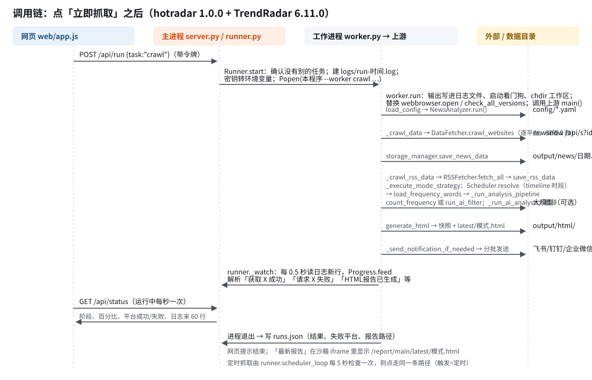

返回 [项目阅读入口](<00 项目阅读入口.md>)。本篇对应热点雷达 1.0.0、上游 TrendRadar 6.11.0（提交 `ceabb02`）。

## 1. 要解决什么问题

上游 TrendRadar 本来是一个**命令行定时任务**：在 GitHub Actions、Docker 或自己的服务器上每隔一段时间运行一次 `python -m trendradar`，抓热榜 → 筛选 → 生成 HTML 报告（挂到 GitHub Pages）→ 推送到群机器人。它的配置是几个 YAML/TXT 文件，没有桌面界面；另有一个 MCP 服务器供 AI 客户端查询数据。

热点雷达要做的是：**不改上游的业务逻辑**，给它加一层桌面外壳，让不懂命令行的人在 Mac 或 Windows 上双击打开，就能抓取、看报告、改关键词、配推送和 AI，并满足本仓库的交付要求（安装包、应用窗口、关窗即停、使用指南、运行状态、缩放）。

## 2. 架构图


四块：

| 部分 | 进程 | 职责 |
| --- | --- | --- |
| 应用窗口 | 主进程里的 pywebview（Windows 另有 WebView2 子进程） | 显示 `hotradar/web/` 网页；关窗即退出 |
| 主进程（外壳） | `HotRadar` / `HotRadar.exe` | 本机 HTTP 服务、配置读写、任务管理、定时抓取、报告与文档的白名单读取、进程状态 |
| 工作进程 | 同一程序加 `--worker 任务` 参数，按需启动 | 在用户数据目录里运行上游 TrendRadar 一次（抓取/离线演示/推送测试/体检），或常驻运行上游 MCP 服务（可选） |
| 用户数据目录 | — | 上游原生格式的配置、密钥、SQLite 历史、HTML 报告、运行记录 |

外部服务：newsnow 热榜接口（第三方）、RSS 源、大模型服务商（经 LiteLLM）、推送渠道、cdnjs（报告里「保存为图片」按钮）。**只有工作进程访问外网**，主进程只监听 `127.0.0.1`。

## 3. 上游 TrendRadar 的组织

```text
upstream/
├── trendradar/
│   ├── __main__.py        入口 main() 和 NewsAnalyzer：一次运行的总流程
│   ├── context.py         AppContext：把配置、存储、调度、报告、推送串起来
│   ├── core/              loader.py 读 config.yaml + 环境变量；frequency.py 关键词解析与匹配；
│   │                      analyzer.py 统计与加权排序；scheduler.py 按 timeline.yaml 决定本次推不推、分不分析
│   ├── crawler/           fetcher.py 请求 newsnow（重试、域名校验）；rss/ 抓取与解析 RSS
│   ├── storage/           local.py 本地 SQLite（每天一个库）；remote.py S3 远程存储（桌面版不用）；*.sql 表结构
│   ├── ai/                client.py（LiteLLM）、analyzer.py AI 分析、filter*.py AI 筛选、translator.py 翻译
│   ├── report/            html.py / rss_html.py 生成 HTML 报告；generator.py 写文件
│   ├── notification/      dispatcher.py 分发；senders.py 9 种渠道；splitter.py 按字节分批
│   └── commands/          --doctor 体检、--test-notification 推送测试、版本检查
├── mcp_server/            FastMCP 服务器：server.py 注册 20 多个工具，tools/ 下按功能分文件
├── config/                默认配置：config.yaml、frequency_words.txt、ai_interests.txt、timeline.yaml、提示词
└── tests/                 上游自带的离线测试
```

上游的一个关键约定：**按当前工作目录下的 `config/` 和 `output/` 工作**（相对路径）。所以外壳只要在用户数据目录里启动上游，配置和数据就都落在用户数据目录。

## 4. 外壳的组织

```text
hot-radar/
├── run.py                 入口：普通启动 → hotradar.app.main；--worker → hotradar.worker.main
├── hotradar/
│   ├── app.py             窗口与启停（pywebview，失败改浏览器），退出收尾
│   ├── server.py          本机 HTTP 服务：接口、静态网页、报告、安全校验
│   ├── runner.py          任务管理：启停工作进程、读日志算进度、运行记录、定时抓取、MCP 进程、跨实例锁
│   ├── worker.py          工作进程入口：输出重定向、看门狗、运行时替换、调用上游
│   ├── configio.py        配置读写：工作区初始化、config.yaml 白名单字段（保留注释）、密钥、文本配置
│   ├── keywords.py        单独加载上游 frequency.py，解析与试匹配
│   ├── reports.py         报告清单、最新报告、路径白名单
│   ├── guide.py           使用指南：文档/附件/源码清单与 zip
│   ├── procinfo.py        进程与内存
│   ├── paths.py           数据目录、安装包内资源位置
│   └── web/               index.html、app.js、guide.js、zoom.js、md.js、style.css、icon.svg
├── upstream/              上游源码（6 处补丁）
├── samples/               离线演示夹具（上游样例库整理）
├── packaging/             build.py（PyInstaller + dmg/NSIS）、installer.nsi、make_icon.py、smoke.py（冒烟测试）
├── tests/                 test_hotradar.py、web.test.js
└── docs/                  本文档
```

## 5. 主要调用链

### 点「立即抓取」



1. `web/app.js` `run("crawl")` → `POST /api/run`（带令牌）。
2. `server.py` → `Runner.start("crawl")`：检查本实例和其他实例（`.job.lock`）都没有任务在跑；`configio.ensure_workspace` 补齐默认配置；建 `logs/run-时间.log`；把 `secrets.json` 转成环境变量；`subprocess.Popen(本程序 --worker crawl --workspace 数据目录 --log 日志 --parent 主进程PID)`；起 `_watch` 线程。
3. 工作进程 `worker.run`：把 stdout/stderr 写进日志文件 → `start_watchdog`（每 2 秒查主进程）→ `chdir(工作区)` → 替换 `webbrowser.open`、`check_all_versions` → `trendradar.__main__.main()`。
4. 上游 `main()` → `load_config()` → `NewsAnalyzer.run()`：
   `_crawl_data()`（`DataFetcher.crawl_websites` 逐平台请求 newsnow，失败重试 2 次；`storage_manager.save_news_data` 写 SQLite）→
   `_crawl_rss_data()`（`RSSFetcher.fetch_all`）→
   `_execute_mode_strategy()`（`Scheduler.resolve` → `load_frequency_words` → `_run_analysis_pipeline`：`count_frequency` 或 `run_ai_filter`、`_run_ai_analysis`、翻译、`generate_html`）→
   `_send_notification_if_needed()`（`NotificationDispatcher` → `senders.py`）。
5. 主进程 `_watch` 每 0.5 秒读日志新行交给 `Progress.feed`，按上游的固定输出（「监控平台数量: N」「获取 X 成功」「请求 X 失败: …」「成功: […], 失败: […]」「[RSS] …」「HTML报告已生成: …」）算阶段和百分比；报错用 `humanize_error` 归成中文。
6. 网页每秒 `GET /api/status`，显示阶段、平台标签、日志末 60 行。
7. 工作进程退出 → `_watch` 写 `runs.json`（结果、成功/失败平台、报告路径、耗时）、删 `.job.lock`。

### 定时抓取

`Runner.scheduler_loop` 线程每 5 秒检查：开启且到点、没有任务在跑 → 走同一条 `start("crawl", trigger="定时")`。设置存在 `settings.json`；关窗时线程随 `stop_event` 停止。

### 改配置

`POST /api/config {changes}` → `configio.update`：每个字段按白名单校验（类型、范围、枚举、网址、ID 格式）→ 全部通过才用 ruamel.yaml 往返写回（保留注释和引号；列表按 id 合并，挪动「下一节」的分隔注释）→ 再读一遍确认合法 → 备份旧文件为 `.bak` → 原子替换。密钥走 `POST /api/secrets` → `secrets.json`。

### 关键词检查

`POST /api/keywords/check` → `keywords.parse` 用 `importlib` 按文件路径加载上游 `trendradar/core/frequency.py`（不触发上游包初始化，主进程不用加载 LiteLLM）→ `load_frequency_words` / `matches_word_groups`。

### 退出

窗口关闭事件 / `POST /api/quit` → `app.quit_event` → `app.shutdown`：`Runner.shutdown`（停定时线程、`stop_process` 结束抓取和 MCP 进程并等待退出）→ `httpd.shutdown()` + `server_close()` 释放端口。

## 6. 进程模型

| 进程 | 何时存在 | 结束方式 |
| --- | --- | --- |
| 主进程 | 应用打开期间 | 关窗/退出；崩溃时连同它的线程一起结束 |
| WebView2 子进程（Windows） | 窗口存在期间 | 随窗口结束 |
| 抓取工作进程 | 一次任务期间（几秒到几分钟） | 自然结束；「停止」或退出时主进程先 terminate、5 秒后 kill；主进程不在时看门狗让它 2 秒内退出 |
| MCP 服务进程 | 用户打开 MCP 服务期间 | 同上 |

主进程内的线程：`MainThread`（窗口）、`http`（服务）、`scheduler`（定时）、`watch-任务`（读日志）、每个请求一个短命线程。同一时间最多一个抓取工作进程。

## 7. 数据位置

| 内容 | macOS | Windows |
| --- | --- | --- |
| 数据目录 | `~/Library/Application Support/HotRadar/` | `%LOCALAPPDATA%\HotRadar\` |
| 安装位置 | `/Applications/热点雷达.app` | `%LOCALAPPDATA%\Programs\HotRadar\` |

数据目录里：`config/`（上游配置）、`secrets.json`、`settings.json`（定时抓取、MCP 端口）、`runs.json`、`logs/`、`output/`（`news/`、`rss/` SQLite；`html/` 报告；`index.html`）、`index.html`（上游写到工作目录的报告入口）、`version*`（上游版本文件，MCP 读取）、`demo/`（离线演示工作区）、`hotradar.log`、`webview/`、`.hotradar-version`（记录配置初始化时的版本）、`.job.lock`（任务锁）。开发和测试时可用环境变量 `HOTRADAR_DATA` 指定别的目录。

安装包里（只读）：`project/` 是完整源码树（网页、上游默认配置、样例、文档都从这里读）；上游和外壳的 Python 模块编译进程序本体；`trendradar/storage/*.sql` 放在模块旁边供上游读取。

## 8. 安全设计

- 服务只绑 `127.0.0.1`，每次启动随机端口和随机令牌；所有请求校验 `Host`（防 DNS 重绑定），写操作再校验 `Origin` 和令牌头 `X-HotRadar-Token`。
- 页面 CSP 禁止外部脚本；上游报告放进**沙箱 iframe**（不给 `allow-same-origin`），报告里的脚本拿不到令牌、不能调用写接口；报告响应有单独的 CSP，只允许内联脚本和 cdnjs。
- 报告、文档、源码一律按白名单读取，路径必须精确匹配清单或固定格式，`../` 无效。
- 密钥不进 `config.yaml`，界面只显示末 4 位，以环境变量传给工作进程；`secrets.json` 在 macOS/Linux 上设为仅本人可读。
- 上游自带的防篡改：newsnow 返回的链接必须是 https 且属于该平台的「校验域名」，否则整个平台丢弃。

## 9. 和上游原本的运行方式相比

| | 上游 TrendRadar | 热点雷达 |
| --- | --- | --- |
| 运行 | GitHub Actions 定时 / Docker / 命令行 | 桌面窗口，手动或窗口开着时定时 |
| 配置 | 编辑 YAML/TXT，或 GitHub Secrets | 界面编辑，写回同样的文件；密钥在 `secrets.json` |
| 看报告 | GitHub Pages / 本地浏览器 / 邮件 | 窗口内沙箱 iframe，也可在浏览器打开 |
| 存储 | 本地 SQLite 或 S3 远程 | 只用本地 SQLite |
| MCP | 单独命令启动 | 界面开关，随应用停止 |
| 版本检查 | 每次运行访问 GitHub | 关闭（上游代码随安装包更新） |
