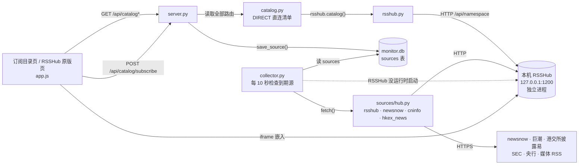

本篇讲软件要解决的问题、由哪些部分组成、彼此怎么调用、数据放在哪里。更细的接口表、数据表和扩展方向见 [ARCHITECTURE（原架构说明）](<ARCHITECTURE.md>)；源码怎么读见 [03 源码阅读与重建指南](<03 源码阅读与重建指南.md>)。

## 1. 软件要解决什么问题

炒股或做品牌监测时，相关消息分散在新浪、东方财富、财联社、搜索引擎和各种 RSS 里。本应用把这些来源定时抓到本机，按监控对象归类，自动判断利好/利空、识别风险词，有异常时弹出预警，让你在一个窗口里看全。

设计原则：

- **本机运行**：数据只在自己电脑上，服务只监听 `127.0.0.1`。
- **纯标准库**：后台只用 Python 标准库（psutil 可选，只用于运行状态页），打包体积小。
- **前后台一起开一起关**：窗口关掉，后台和采集就停，不留常驻进程。
- **离线可读**：界面、图表、Markdown 渲染器都随应用打包，不依赖 CDN。

## 2. 架构图


同一张图的文字版（CJK 字符在部分等宽字体下可能对不齐）：

```text
┌────────────────────────── 应用窗口（Edge / Chrome --app，独立配置目录）──────────────────────────┐
│  index.html + app.js + style.css + markdown.js                                                   │
│  总览 · 资讯流 · 监控对象 · 数据源 · 预警中心 · 运行状态 · 使用指南 · 设置   顶部：缩放 / 版本 / 退出 │
└──────────────┬──────────────────────────────────────────────▲───────────────────────────────────┘
               │ HTTP JSON 请求（fetch）                        │ SSE 推送 /api/events
               ▼                                               │ hello · articles · alert · source · shutdown
┌──────────────────────────── 后台服务进程（run.py，Python）────────────────────────────────────────┐
│  server.App ── RequestHandler ── 路由表 /api/*      静态文件 web/      使用指南 guide.py   procinfo.py │
│       │                                   ▲                                                       │
│       │ 调用                              │ publish                                               │
│       ▼                                   │                                                       │
│  collector.Collector ──► sources/* 抓取 ──► sentiment 打分 ──► matcher 匹配 ──► db.Store 入库 ──► EventBus │
│   （1 个调度线程 + 最多 4 个抓取线程）                                                               │
│  lifecycle.Watchdog：窗口进程结束或页面全部断开 ≥ 10 秒 → App.shutdown()                            │
└──────────────┬───────────────────────────────────────────┬──────────────────────────────────────┘
               │ urllib（可走代理）                          │ sqlite3（WAL）
               ▼                                           ▼
     外部消息来源：新浪 / 东财 / 财联社 /            数据目录：monitor.db · monitor.log · browser-profile/
     必应 / Google / Yahoo / RSS / 行情接口
```

[ARCHITECTURE](<ARCHITECTURE.md>) 里还有三张 Mermaid 图（总体结构、启停时序、采集流水线）。应用内以源码形式显示，在 GitHub 或 Obsidian 里会渲染成图。

### v0.3 新增：订阅目录与外部服务



- 本机 RSSHub 是**独立的外部服务**（Node.js 进程，不属于本应用）：本应用只通过 HTTP 调用；可以一键启动它，但退出时不停止它。
- 请求本机地址（127.0.0.1）时不走代理，避免设置了代理后连不上本机 RSSHub。

## 3. 模块组成

| 层 | 模块 | 职责 |
|---|---|---|
| 入口 | `run.py` | 参数解析、单实例检测、启动服务和采集、打开应用窗口、注册信号和看门狗、退出收尾 |
| 生命周期 | `monitor/lifecycle.py` | 找 Edge/Chrome 并以 `--app` 打开窗口；`Watchdog` 判断何时退出 |
| 服务 | `monitor/server.py` | `App`：路由注册、退出流程；`RequestHandler`：分发、静态文件、SSE、防 DNS 重绑定和跨站请求 |
| 采集 | `monitor/collector.py` | 调度循环、线程池抓取、去重入库、预警判断、推送事件 |
| 数据源 | `monitor/sources/` | 每种来源一个类，`fetch()` 返回统一格式的资讯列表；v0.3 新增 `hub.py`（RSSHub、热榜、巨潮、港交所） |
| 订阅目录（v0.3） | `monitor/catalog.py`、`monitor/rsshub.py` | 直连源清单、RSSHub 路由目录的读取/拍平/分类/搜索；RSSHub 状态与启动 |
| 分析 | `monitor/sentiment.py`、`monitor/matcher.py` | 情感打分和风险词；资讯与监控对象匹配 |
| 存储 | `monitor/db.py` | SQLite：对象、数据源、资讯、预警、设置 |
| 推送 | `monitor/events.py` | SSE 事件总线，同时统计页面连接数（看门狗用） |
| 使用指南 | `monitor/guide.py` | 文档和源码白名单读取、源码 zip |
| 运行状态 | `monitor/procinfo.py` | 各进程 PID 和内存 |
| 界面 | `monitor/web/` | 单页应用：hash 路由、手写 SVG 图表、缩放、Markdown 渲染 |

## 4. 主要调用链

**打开应用**：`run.main()` → `App()`（打开数据库、建 `Collector`）→ `App.make_server()` → `Collector.start()` → `BrowserWindow.open()` → `Watchdog.start()` → `httpd.serve_forever()`。

**一次采集**：`Collector._loop()` 每 10 秒检查到期的数据源 → `_submit()` 放进线程池 → `run_source()` 调 `sources.get(type).fetch()` → `ingest()`：`sentiment.analyze()` 打分、`Matcher.match()` 找对象、`Store.add_article()` 去重入库、`_alerts_for()` 判断预警 → `EventBus.publish("articles"/"alert")` → 页面 SSE 收到后刷新。

**订阅目录**（v0.3）：`#/catalog` → `GET /api/catalog/categories`（`catalog.all_items()` → `rsshub.catalog()` 读本机 RSSHub `/api/namespace`，6 小时缓存）→ `GET /api/catalog?cat=&q=` → `catalog.search()` 筛选排序，并标出已订阅、实测、本机测试结果 → 点「订阅」`POST /api/catalog/subscribe` → `Store.save_source()` 写一行数据源 → `Collector.run_now()` 立即抓一次。

**页面请求**：`fetch('/api/…')` → `RequestHandler._dispatch()`（检查 Host 和 `X-Monitor` 头）→ 路由函数 → `Store` 查询 → JSON。

**退出**：关窗 → SSE 断开 → `Watchdog.check()` 发现窗口进程结束或断开 ≥ 10 秒 → `App.shutdown()`：推送 `shutdown` 事件、`Collector.stop()`、关闭应用窗口、`httpd.shutdown()` → `run.main()` 的 `finally` 关闭端口和数据库。页面「退出」按钮走 `POST /api/shutdown`，同一流程。

**使用指南**：`#/guide` → `GET /api/guide/docs` 列出 README 和 `docs/` → `GET /api/guide/doc?path=` 取原文 → `markdown.js` 渲染；源码页 `GET /api/guide/sources`、`/api/guide/source?path=`（白名单）、`/api/guide/source.zip`。

## 5. 数据位置

| 内容 | 位置 |
|---|---|
| 数据库 `monitor.db`、日志 `monitor.log`、应用窗口配置 `browser-profile/` | macOS `~/Library/Application Support/SentimentMonitor/`；Windows `%APPDATA%\SentimentMonitor\`；Linux `~/.local/share/sentimentmonitor/` |
| 界面缩放、深浅色 | 应用窗口的本地存储（localStorage，在 `browser-profile/` 里） |
| 打包进程序的文档和源码副本 | 程序目录内 `guide/`、`source/`（只读，随版本更新） |

命令行 `--data-dir` 或环境变量 `MONITOR_DATA_DIR` 可以改数据目录。

## 6. 进程模型

| 进程 | 由谁启动 | 何时结束 |
|---|---|---|
| 后台服务（Python） | 用户双击程序 | 窗口关闭 / 退出 / 收到退出信号 |
| 应用窗口（Edge/Chrome 主进程及其子进程） | 后台服务 | 用户关窗；后台退出时由后台关闭 |
| 采集任务 | 后台服务内的线程，没有独立进程 | 随后台服务 |

这些在应用的「运行状态」页实时列出，口径见 [使用指南](<01 使用指南.md>) 第 7 节。
