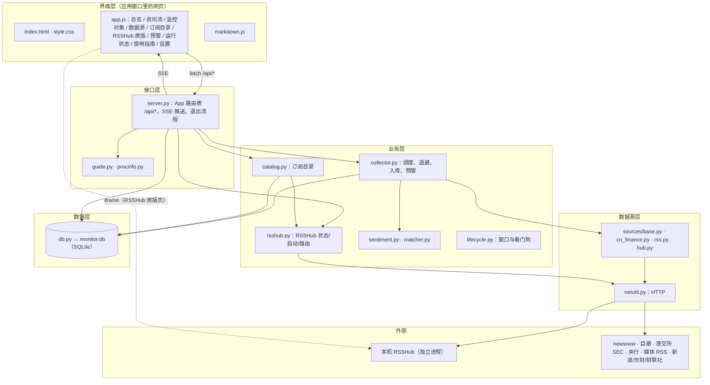

> 源码精读是给初学者的逐函数讲解教材，比 [03 源码阅读与重建指南](<../03 源码阅读与重建指南.md>) 细得多。**本版（v0.3.0）先精读这次新增和改动的模块**；v0.1–v0.2 留下的其余模块还没有精读，覆盖清单里如实标「待精读」，后续按模块补齐。

## 1. 代码规模

统计方法：本项目自带的 Python 小脚本按行分类（空行；以 `#`、`//`、`/*`、`*` 开头的注释行；其余算代码行）。没有用 `cloc`（本机未安装），所以多行字符串文档（`"""…"""`）计入代码行。源码基准：规模表和 01 篇按 **v0.3.0 提交 `fa2c741`**（统计日期 2026-10-21）；02 篇和下面覆盖清单里标「v0.3.1」的行号按 **v0.3.1 提交**（2026-10-22，见 06 验收记录）。同一个函数在两个版本里的行号可能不同，以各篇标注的基准为准。

| 目录/文件 | 语言 | 文件数 | 代码行 | 注释行 | 空行 | 是否手写 |
|---|---|---|---|---|---|---|
| `run.py` | Python | 1 | 107 | 2 | 30 | 手写 |
| `monitor/*.py` | Python | 15 | 2214 | 59 | 361 | 手写 |
| `monitor/sources/*.py` | Python | 5 | 474 | 5 | 83 | 手写 |
| `monitor/web/app.js` | JavaScript | 1 | 1272 | 28 | 31 | 手写 |
| `monitor/web/markdown.js` | JavaScript | 1 | 156 | 11 | 8 | 手写 |
| `monitor/web/style.css`、`index.html` | CSS / HTML | 2 | 339 | 15 | 20 | 手写 |
| `packaging/*.py` | Python | 3 | 191 | 2 | 39 | 手写 |
| `tests/*.py` | Python | 2 | 608 | 4 | 105 | 手写 |
| **手写合计** | | **30** | **约 5360** | | | |
| `monitor/catalog_tested.json` | JSON 数据 | 1 | — | — | — | 脚本生成（`packaging/catalog_check.py`），不精读 |
| Python 标准库、psutil、PyInstaller 产物 `build/` `dist/` | — | — | — | — | — | 第三方 / 生成，不精读 |
| RSSHub | TypeScript | — | — | — | — | 外部独立程序（AGPL-3.0），不在本仓库，不精读 |

## 2. 分层架构图



## 3. 模块依赖（谁 import 谁，v0.3 相关部分）

```text
server.py   → catalog, rsshub, sources, collector, db, guide, procinfo, events, quotes
catalog.py  → rsshub
rsshub.py   → netutil
collector.py→ netutil, rsshub, sentiment, sources, matcher
sources/hub.py → netutil, rsshub, sources/base, （函数内）sources/rss
netutil.py  → 只用标准库
```

没有循环依赖：`hub.py` 用到 `rss.parse_feed` 时在函数内部导入，`rsshub.py` 不导入 `sources`。

## 4. 一次完整请求的追踪：在订阅目录里点「订阅」

| 步 | 位置 | 做什么 |
|---|---|---|
| 1 | `app.js:697` `PAGES.catalog` | 打开 `#/catalog`，先请求分类 `loadCategories()`，再请求一页条目 `loadCatalog()` |
| 2 | `server.py:241` `/api/catalog/categories` | `catalog.all_items()` → `rsshub.catalog()`：6 小时内用缓存，否则请求本机 RSSHub `/api/namespace` 并 `_flatten()` |
| 3 | `server.py:247` `/api/catalog` | `catalog.search()` 按分类、关键词筛选排序分页；逐条算 `default_feed`、`feed_key`，标出已订阅、实测、本机测试 |
| 4 | `app.js:786` `renderCatalog()` | 画列表和标签；点「订阅」触发 `subscribeItems()` |
| 5 | `app.js:817` `itemToSource()` | 目录项 → `{type, params, name, category, interval, only_matched}` |
| 6 | `server.py:266` `/api/catalog/subscribe` | 去重后 `Store.save_source()` 写入 `sources` 表；`Collector.run_now(id)` 立即抓一次 |
| 7 | `collector.py` `_submit()` → `run_source()` | 线程池里调 `sources.get("rsshub").fetch()` |
| 8 | `hub.py:24` `RsshubSource.fetch()` | `netutil.fetch("http://127.0.0.1:1200/…")`（本机不走代理）→ `parse_feed()` |
| 9 | `collector.py:146` `ingest()` | 情感打分、匹配监控对象；「只存命中」的源丢掉不命中的；`add_article()` 去重入库；判断预警 |
| 10 | `events.py` → `app.js` | SSE 推送 `source`、`articles` 事件，数据源页和资讯流自动刷新 |

## 5. 核心数据结构

**`sources` 表**（v0.3 新增后三列）：

| 字段 | 含义 | 样例 |
|---|---|---|
| `id` | 主键（每行唯一的编号） | 12 |
| `type` | 数据源类型，对应 `sources.REGISTRY` 的键 | `rsshub` |
| `name` | 显示名称 | `财联社·电报` |
| `params` | 参数，JSON 文本 | `{"path": "/cls/telegraph"}` |
| `enabled` | 是否启用 | 1 |
| `interval_min` | 抓取间隔（分钟） | 10 |
| `last_run` / `last_ok` | 上次运行 / 上次成功的 Unix 秒 | 1792594000 |
| `last_error` | 上次错误（成功后清空） | `` |
| `last_count` / `last_new` / `total` | 上次获取条数 / 上次新增 / 累计入库 | 20 / 3 / 158 |
| `category`（v0.3） | 分类 id（RSSHub 的分类），用于数据源页分组 | `finance` |
| `catalog_key`（v0.3） | 从目录订阅时的订阅地址，用于判断「已订阅」 | `/cls/telegraph` |
| `fail_count`（v0.3） | 连续失败次数，用于退避；成功清零 | 0 |

**目录项**（`catalog.search()` 返回、`/api/catalog` 输出的每一条）：

```json
{"key": "/cls/telegraph/:category?", "ns": "cls", "site": "财联社", "site_url": "cls.cn", "lang": "zh-CN",
 "name": "电报", "path": "/cls/telegraph/:category?", "example": "/cls/telegraph",
 "params": {"category": "分类，见下表"}, "required": [], "needs": [], "categories": ["finance"],
 "feed": {"type": "rsshub", "params": {"path": "/cls/telegraph"}}, "feed_key": "/cls/telegraph",
 "subscribed": null, "tested": {"n": 20, "latest": "2026-10-21", "at": "2026-10-21"}, "health": null}
```

**资讯条目**（每个数据源 `fetch()` 返回的统一格式）：`{title, summary, url, media, published_at（Unix 秒）, entity_ids?}`。

## 6. 阅读顺序建议

| 顺序 | 读什么 | 预计 |
|---|---|---|
| 1 | [01 订阅目录与新数据源](<01 订阅目录与新数据源.md>) 第 1–3 节：先看全貌和函数表 | 20 分钟 |
| 1.5 | [02 按监控对象查公告与更新 RSSHub](<02 按监控对象查公告与更新 RSSHub.md>)（v0.3.1） | 40 分钟 |
| 2 | `monitor/sources/base.py` 的 `Source` 类，再读 01 篇 4.1–4.4 四个数据源 | 40 分钟 |
| 3 | 01 篇 4.5–4.7：RSSHub 目录和 `catalog.py` | 40 分钟 |
| 4 | 01 篇 4.8–4.10：网络、数据库、调度的改动 | 30 分钟 |
| 5 | 01 篇 4.11–4.12：接口和页面，在应用里边点边对照 | 30 分钟 |
| 6 | 做 01 篇第 7 节的练习，跑 `python -m unittest discover -s tests -v` 验证 | 1 小时 |

## 7. 覆盖清单

函数列表用 Python 的 `ast` 模块从源码扫出（未标 v0.3.1 的行行号按 `fa2c741`）（`ast` 是 Python 自带的「把源码解析成语法树」的工具，能可靠找出每个 `def`）。行号对应第 1 节的源码基准。

| 文件 | 函数总数 | 已精读 | 已精读的函数（名称:行号） | 状态 |
|---|---|---|---|---|
| `monitor/sources/hub.py` | 4 | 4 | `RsshubSource.fetch`:24、`NewsnowSource.fetch`:43、`CninfoSource.fetch`:84、`HkexNewsSource.fetch`:125 | 已精读（v0.3） |
| `monitor/rsshub.py` | 9 | 9 | `base_url`:44、`url_for`:48、`is_local`:55、`explain_error`:59、`status`:70、`start_command`:81、`start`:94、`_flatten`:113、`catalog`:151 | 已精读（v0.3） |
| `monitor/catalog.py` | 9 | 9 | `_d`:17、`_rss`:26、`_hot`:30、`tested`:142、`feed_key`:150、`default_feed`:159、`all_items`:169、`categories`:174、`search`:184；另有 `DIRECT` 清单（第 39 行起） | 已精读（v0.3） |
| `monitor/sources/hub.py`（v0.3.1 新增部分） | +8 | +8 | `_DailyCache.__init__`:155、`_DailyCache.get`:160、`_load_cninfo_orgs`:168、`_cninfo_target`:184、`CninfoStockSource.fetch`:204、`_load_sec_ciks`:243、`SecFilingsSource.fetch`:275；常量 `SEC_FORMS`、`SEC_DEFAULT_FORMS` | 已精读（[02 篇](<02 按监控对象查公告与更新 RSSHub.md>)） |
| `monitor/rsshub.py`（v0.3.1 新增部分） | +10 | +10 | `source_dir`:178、`_env`:184、`_run`:191、`update_status`:201、`check_behind`:210、`start_update`:227、`_step`:239、`_do_update`:246、`_finish`:302、`_stop_local`:307 | 已精读（02 篇） |
| `monitor/netutil.py` | 7 | 4 | `_opener`:32、`_sec_headers`:61、`fetch`:73、`_fetch`:85 | v0.3 改动部分已精读；`_decode`、`fetch_json`、`q` 待精读 |
| `monitor/db.py` | 42 | 2 | `Store._migrate`:166、`Store._fix_v02_defaults`:222 | v0.3 改动部分已精读；其余 40 个方法待精读 |
| `monitor/collector.py` | 16 | 4 | `Collector._loop`:56、`Collector._maybe_start_rsshub`:79、`Collector.ingest`:146（只存命中部分）、`_due`:212 | v0.3 改动部分已精读；其余待精读 |
| `monitor/server.py` | 24 | 1 + 6 个接口 | `App._catalog_health`:381；`_register()` 内 v0.3 的 6 个接口函数（`rsshub_status`、`rsshub_start`、`catalog_categories`、`catalog_list`、`catalog_subscribe`、`catalog_health_save`） | v0.3 部分已精读；其余待精读 |
| `monitor/web/app.js` | — | v0.3 部分 | `itemToSource`、`testCatalogPage` 逐行；`PAGES.catalog`、`hubStatus`、`loadCategories`、`loadCatalog`、`catalogBadges`、`renderCatalog`、`subscribeItems`、`testCatalogItem`、`catalogParamForm`、`PAGES.rsshub`、`PAGES.sources`、`renderSources`、`sourceRow`、`sourceStatus`、`sourceForm`、`testResultHTML` 按职责讲解 | 部分已精读；其余页面待精读 |
| `run.py`、`lifecycle.py`、`events.py`、`guide.py`、`procinfo.py`、`paths.py`、`quotes.py`、`sentiment.py`、`matcher.py`、`demo.py`、`sources/base.py`、`sources/cn_finance.py`、`sources/rss.py`、`markdown.js`、`style.css`、`index.html`、`packaging/*`、`tests/*` | — | 0 | — | **待精读**（v0.1–v0.2 的代码，目前只有 [03 源码阅读与重建指南](<../03 源码阅读与重建指南.md>) 的文件级说明） |

人工核对（工具扫不到的控制流）：`Store.__init__` 里先 `executescript(SCHEMA)` 再 `_migrate()` 的顺序；`_seed()` 对新老用户的两条分支；`Collector._loop()` 的 10 秒节拍；`/api/catalog/health` 的加锁读-改-写。以上已在 01 篇对应小节讲解。
