这篇写给要用这个应用的人，没打开应用也能读懂。按交付要求分八部分：开始和结束、主要任务、数据来源、结果怎么理解、出了问题怎么办、软件框架与源码、进程与内存、界面缩放。两个平台不同的地方分别写。

**1.1.0 新增**（用户看了 1.0.3 后觉得知识卡片「能用但画面很 low」）：视频来源「程序生成」组多了「**知识讲解卡片（AI 导演）**」和「**知识讲解卡片 + AI 插图**」，原来的方案改名「知识讲解卡片（规则切分）」原样保留，方便对比（第 2.4 节讲清每种来源的原理）；新的「**工坊主题**」（第 2.4.4 节）；生成完成后能在顶部「**审片 / 分镜**」里一次看完每一页画面（第 2.12 节）；大模型调用记录搬到新的顶层标签页「**模型调用**」，标明谁说的、哪些是程序填进去的变量、上一次的输出怎样进了下一次的输入（第 2.9 节）；「**字数控制方式**」三档（第 2.11 节）。


## 1. 怎样开始和结束

### 1.1 安装和第一次打开

**macOS（Apple 芯片，M1–M4）**

1. 从 [Releases 页面](https://github.com/luoxuran1982/claude2/releases) 下载 `ShortVideoFactory-1.1.0-macOS-arm64.dmg`（约 430 MB）。
2. 双击打开 dmg，把「AI 短视频工厂.app」拖到旁边的「应用程序」文件夹。
3. 第一次打开：在「应用程序」里**右键**「AI 短视频工厂」→「打开」→ 在弹窗里再点「打开」。应用没有 Apple 开发者签名，直接双击会提示「无法验证开发者」。如果右键打开仍被拦，到「系统设置 → 隐私与安全性」，在下方找到「已阻止打开 AI 短视频工厂」，点「仍要打开」。
4. 以后在「应用程序」或启动台里直接双击即可。

**Windows（x64）**

1. 从 [Releases 页面](https://github.com/luoxuran1982/claude2/releases) 下载 `ShortVideoFactory-Setup-1.1.0-x64.exe`。
2. 双击安装。程序装到 `%LOCALAPPDATA%\Programs\ShortVideoFactory\`，不需要管理员权限；装完在开始菜单和桌面各有一个「AI 短视频工厂」快捷方式。
3. 应用没有代码签名，SmartScreen 提示「Windows 已保护你的电脑」时点「更多信息 → 仍要运行」。杀毒软件拦截时见第 5 节。
4. 不想安装可以下载 `ShortVideoFactory-1.1.0-windows-x64.zip`，解压到任意文件夹，双击里面的 `ShortVideoFactory.exe`。
5. 窗口用的是系统自带的 Microsoft Edge WebView2。Windows 10/11 一般都已装好；极少数精简系统没有时，应用会自动改用默认浏览器打开同样的界面（原因写在日志里）。

**打开后**：先出现带顶栏的窗口，「视频生成」页显示「正在启动生成界面…」。第一次启动要加载视频处理组件，一般 10–40 秒（慢的电脑可能 1–2 分钟），之后出现 MoneyPrinterTurbo 的界面。第一次还会弹出 3 步的新手引导（上游自带），可以跟着点，也可以点 × 关掉。

### 1.2 第一次要准备的东西

| 东西 | 必需吗 | 费用 | 在哪填 |
| --- | --- | --- | --- |
| 大模型 API Key | 让 AI 写文案时必需；自己写好文案可以不填 | 按量付费，一条视频几分钱以内（见第 4 节） | 生成界面右上角「设置 → 大模型设置」 |
| 素材钥匙（推荐 Pixabay） | 只有用库存视频（Pixabay / Pexels / 混合）时需要；选「知识讲解卡片」（三种都是）**不需要** | 免费 | 「设置 → 素材来源设置」 |
| OpenAI 兼容文生图 | 只有「知识讲解卡片 + AI 插图」和上游的「AI 生图」来源需要 | 按张计费（看服务商） | 「设置 → 素材来源设置 → OpenAI 兼容文生图」：接口地址、模型、钥匙 |
| 素材下载代理 | 可选：你的网络要代理才能访问素材站时填 | — | 「设置 → 素材来源设置」底部（见第 2.5 节） |
| 背景音乐 mp3 | 可选 | 看来源 | 放进数据目录的 `songs/` 文件夹 |

**先决定用哪种画面**（详见第 2.4 节）：讲概念、原理、步骤、对比、数字的知识类主题（例如「逻辑门」「光合作用」「复利怎么算」）选「**知识讲解卡片（AI 导演）**」（已经配好大模型时；画面最好）或「**知识讲解卡片（规则切分）**」（完全不调用大模型画分镜），什么素材钥匙都不用；情绪、生活、风景、美食、旅行这类靠实拍画面好看的主题用 **Pixabay** 库存视频；拿不准就选「**混合**」。

**申请 Pixabay 免费钥匙（推荐，约 2 分钟）**

1. 打开 <https://pixabay.com/api/docs/>，点右上角登录或注册（邮箱即可）。
2. 登录后回到这个页面，往下翻到「Parameters」一节，`key` 一行里直接显示你的钥匙，格式是「**数字-25 位十六进制**」，例如 `12345678-0123456789abcdef012345678`。
3. **整段复制**（不要手打，容易把 0 和 o、1 和 l 弄混），回到应用：「视频生成」页右上角「设置」→「素材来源设置」→ 粘贴到「Pixabay API Key」。填错栏位或格式不对时，输入框下面会出现黄色提示，例如「这像是 Pexels 的钥匙」。
4. 主界面「视频来源」选「Pixabay」（或「混合：Pixabay 素材 + 知识卡片补齐」）。
5. 搜索时提示 Pixabay 返回 400，说明钥匙无效：从网站重新复制；还不行就在网站上重新生成一个。

Pixabay 素材按 [Pixabay 内容许可](https://pixabay.com/service/license-summary/) 可免费商用、不必署名，但不能原样转卖，素材里可识别的人物、商标不能用于误导性用途。

**关于 Pexels**：Pexels 目前**暂停发放新的 API 钥匙**，新申请的钥匙可能用不了（搜索时返回 401 或返回网页而不是数据，界面会提示「钥匙无效，或者 Pexels 目前暂停发新钥匙」）。以前申请到、仍能用的钥匙照常填在「Pexels API Key」（约 56 位字母和数字、不含横杠，可以填多个，用英文逗号分隔，轮流使用）。没有 Pexels 钥匙就用 Pixabay。

**填大模型 Key**

1. 「设置」→「大模型设置」→「大模型提供商」下拉里选一家。国内常用：DeepSeek（Key 在 <https://platform.deepseek.com/api_keys>）、阿里云通义千问（<https://dashscope.console.aliyun.com/apiKey>）、Kimi / Moonshot（默认选中）、火山引擎豆包、智谱等；也支持任何 OpenAI 兼容接口，以及本机的 Ollama（不需要 Key）。
2. 填「API Key」；「接口地址（Base URL）」和「模型名称」留空就用右侧说明里写的默认值，想换模型就按服务商控制台里的模型名填写。
3. 点「测试模型连接」，看到成功提示即可。

右侧说明框和部分链接是上游作者的推广链接（例如「MoneyPrinterTurbo 专属链接」），用不用随你，直接去服务商官网注册效果一样。所有 Key 只保存在你电脑上数据目录的 `config.toml` 里（见第 3 节），不会上传到任何地方，也不在仓库里。

### 1.3 关闭、退出和最小化

| 操作 | macOS | Windows | 结果 |
| --- | --- | --- | --- |
| 退出应用 | ⌘Q、菜单「AI 短视频工厂 → 退出」、程序坞图标右键「退出」、顶栏右侧「退出」按钮 | Alt+F4、任务栏图标右键「关闭窗口」、顶栏右侧「退出」按钮 | 应用退出：先停止生成界面后台（Streamlit）和它启动的 FFmpeg 等子进程，确认都已结束、端口释放，再关闭窗口 |
| 关闭窗口 | 点左上角红色按钮 | 点右上角 × | 本应用只有一个窗口，关掉它就等于退出，结果同上 |
| 最小化 / 隐藏 / 切到别的应用 | 黄色按钮、⌘H、⌘Tab | 最小化按钮、Alt+Tab | 应用和后台**继续运行**，正在生成的视频不受影响 |

注意：退出会**中断正在生成的视频**（顶栏「退出」按钮会先弹窗确认）。已经生成的视频、你的设置和 Key 都保留。

没有任何「关窗后继续在后台运行」的功能，也没有系统托盘常驻。万一应用崩溃或被强制结束来不及收尾，生成界面后台每 2 秒检查一次启动器还在不在，不在就自行结束（连同 FFmpeg）；Windows 上系统还会通过「作业对象」直接结束它；下次启动时也会检查并清理上次遗留的后台。

再次双击图标时如果应用已经在运行，会把已有窗口调到前面，不会开第二份。

## 2. 怎样完成主要任务（出一条视频）

窗口顶栏有五个栏目：**视频生成**（上游 MoneyPrinterTurbo 的界面）、**审片 / 分镜**（1.1.0，生成完成后逐页看画面，第 2.12 节）、**模型调用**（1.1.0，每次大模型调用的原文，第 2.9 节）、**使用指南**（本文档和全部资料）、**运行状态**（进程与内存）。右侧是缩放控件和「退出」。

### 2.1 最常用的顺序

1. **视频主题**：在「文案设置 → 视频主题」写一句话，例如「为什么夏天容易犯困」。「生成视频脚本的语言」保持「自动检测」或选 zh-CN。**「目标时长（秒）」**（1.0.3）选 30 / 60 / 90 / 120 秒或自定义，大模型会按它写对应字数的文案（第 2.10 节）；选「不限」就和以前一样只按段落数。选了目标时长后下面还有「**字数控制方式**」（1.1.0），默认「程序检查（推荐）」（第 2.11 节）。
2. **生成文案和关键词**：点「点击使用AI生成视频文案和关键词」。大模型先写文案（填进「视频文案」），再生成 5 个英文素材搜索词（填进「视频关键词」）。两处都可以手动改；自己写文案的话直接粘贴，再点「点击使用AI根据文案生成视频关键词」。
3. **视频设置**（右上）：「视频来源」选「知识讲解卡片（AI 导演）」或「知识讲解卡片（规则切分）」（知识类主题，见第 2.4 节）、「Pixabay」（实拍素材）或「混合」，下面会显示这种来源的原理说明和「卡片主题」；「视频比例」竖屏 9:16（抖音/视频号）或横屏 16:9；「视频拼接模式」随机拼接；「单个片段最大时长」默认 3 秒；「同时生成视频数量」默认 1。
4. **音频设置**（左下）：「配音方式」自动配音；「配音服务」默认「Azure TTS V1 (Edge TTS)」（免费，需联网）；「配音声音」默认是中文女声「zh-CN-XiaoxiaoNeural」（晓晓，1.0.1 起首次打开就选好），可换其他 zh-CN 开头的中文声音，点「试听音色」；声音要和文案语言一致——中文文案选了 af-ZA（南非荷兰语）、zu-ZA（祖鲁语）这类外语声音时，声音下拉下面会出现黄色提醒，点「生成视频」时也会再提醒一次（只提醒、不拦），否则微软会返回「No audio was received」导致配音失败；「背景音乐来源」默认随机（`songs/` 里没有 mp3 时不加背景音乐）。
5. **字幕设置**（右下）：默认启用，字体是随应用提供的「NotoSansSC-Bold.ttf」（思源黑体粗体），可调位置、颜色、大小、描边。
6. 点页面最下方红色的「**生成视频**」，**只点一次**：点了以后按钮会变成灰色的「生成中…」，生成结束前不能再点（第 2.7 节）。下方会显示进度、**日志解读**（每一步在做什么，第 2.8 节）、去「**审片 / 分镜**」「**模型调用**」的两个链接（1.1.0）和原始日志：写文案 → 提取关键词 → 配音 → 字幕 → 找素材（知识讲解卡片是「画讲解页」）→ 处理片段 → 拼接 → 最终渲染。用库存视频时，一条 1 分钟左右的视频在普通电脑上一般 3–8 分钟，主要花在下载素材和最终渲染；知识讲解卡片 1.0.3 起走快速通道，50 秒的竖屏视频大约 1 分钟以内。
7. 完成后页面里直接播放成片；点「🎞️ 审片 / 分镜」在顶部同名栏目里一次看完每一页画面（卡片类和库存视频来源都有），点「🤖 模型调用」看这条视频调用大模型的全过程。成片同时自动打开任务文件夹（可在「设置 → 界面设置」关掉）。1.0.3 起「打开目录」由应用主进程（拥有窗口的那个进程）去打开，只允许打开数据目录里面的文件夹；打不开时页面上会显示原因、**完整路径**和「复制路径」按钮，可以粘贴到资源管理器 / 访达里手动打开（第 5 节「打开目录没反应」）。

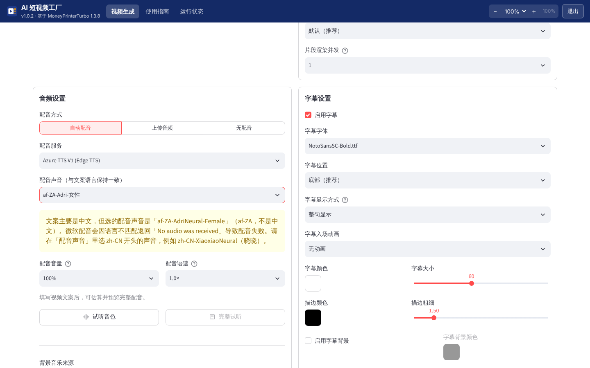

### 2.2 各处按钮的作用

| 位置 | 按钮 / 选项 | 作用 |
| --- | --- | --- |
| 生成界面右上 | 任务管理 | 查看历史任务、播放、打开任务文件夹（由应用主进程用资源管理器 / 访达打开）、重新生成、删除任务；**生成中的任务这一格是 ⏹「取消」**，取消后才能删除（第 2.7 节）；状态列会显示「已取消」「已中断」；1.1.0 起主题下面有「🎞️ 审片 / 分镜」「🤖 模型调用」链接（这个任务有分镜清单、有调用记录时才显示） |
| 生成界面右上 | 设置 | 大模型、素材来源（含钥匙格式提示、素材下载代理）、自动发布（Upload-Post，可选）、界面、密钥备份、缓存管理（「打开缓存目录」同样用资源管理器 / 访达打开） |
| 视频设置 | 卡片主题 | 选了「程序生成」组的来源时出现：工坊深色（1.1.0，AI 知识视频工坊同款）、课堂蓝（浅色）、深夜蓝（深色）、暖纸（米色）。规则切分和 AI 导演各记各的，默认分别是课堂蓝、工坊深色 |
| 视频设置 | 补齐用的卡片 | 选了「混合」时出现：规则切分（默认，不调用大模型）或 AI 导演 |
| 生成界面右上 | Language / 语言 | 界面语言，默认简体中文 |
| 文案设置 | 目标时长（秒） | 1.0.3：不限 / 30 / 60 / 90 / 120 / 自定义；换算成文案字数写进写文案的提示词（第 2.10 节） |
| 文案设置 | 字数控制方式 | 1.1.0：让大模型自己数（严格）/ 程序检查（推荐，默认）/ 不控制（第 2.11 节） |
| 文案设置 | 高级脚本设置 | 段落数、附加要求、自定义系统提示词（「预览最终提示词」里能看到目标时长加的那几行） |
| 生成按钮下方 | 日志解读 / 审片 / 分镜、模型调用链接 / 原始日志 | 按步骤讲解当前在做什么（第 2.8 节）；1.1.0 起大模型调用记录搬到顶层「模型调用」，这里只留链接；原始日志带行号 |
| 外壳顶栏 | 审片 / 分镜 | 1.1.0：选任务（默认最新的），「审片」网格总览、「分镜」逐镜详情（第 2.12 节） |
| 外壳顶栏 | 模型调用 | 1.1.0：选任务，按时间列出每次大模型调用（第 2.9 节） |
| 音频设置 | 上传音频 / 无配音 | 用自己录的配音，或只出画面+字幕 |
| 底部 | 设置预设 | 保存/载入整套参数 |
| 外壳顶栏 | 运行状态 → 打开生成的视频 / 数据文件夹 / 字体文件夹 / 背景音乐文件夹 / 日志 | 在访达或资源管理器里打开对应文件夹 |
| 外壳顶栏 | 运行状态 → 重新启动生成界面 | 生成界面卡住或出错时重启后台（会中断正在生成的视频） |

「视频来源」下拉按组排列：库存视频（Pexels、Pixabay、Coverr）、**程序生成（知识讲解卡片（规则切分）、知识讲解卡片（AI 导演）、知识讲解卡片 + AI 插图、混合：Pixabay / Pexels + 知识卡片补齐）**、AI 视频、AI 生图、本地文件。AI 视频（秘塔/MiniMax、OFox、即梦、火山 Seedance 等）和 AI 生图都是上游接入的**付费**服务，需要各自的 Key，按秒或按条计费，价格在界面上有标注。本应用默认不用它们。

### 2.3 结果在哪

- 每个任务一个文件夹：数据目录 `storage/tasks/<任务编号>/`，里面有 `final-1.mp4`（成片）、`combined-1.mp4`（无字幕拼接版，库存视频来源才有）、`audio.mp3`（配音）、`subtitle.srt`（字幕）、`script.json`（文案和关键词）。
- 1.0.3 起每个任务还有：`llm_calls.jsonl`（大模型调用记录，一行一次调用，第 2.9 节）、`svf_task.json`（目标时长、换算的字数、实际配音时长）、`svf_status.json`（这个任务由哪个后台进程在跑、是否已取消或中断）。
- 用知识讲解卡片或混合来源时还有：`knowledge-cards/page-01.png …`（每页「全部要点都亮起」的完整画面）和 `thumb-01.jpg …`（缩略图）、`knowledge-cards/storyboard.json`（分页结果：每页的版式、标题、要点、起止时间、要点亮起时间）、`svf-cards.plan.json`（快速通道的分页计划）。
- 1.1.0：`svf_storyboard.json`（分镜清单：每页的序号、版式、标题、副标题、起止时间、口播原文和字数、对应句子编号、结构化数据、图片路径，以及这次用的是 AI 导演还是规则切分、导演没用上的原因）——「审片 / 分镜」读的就是它；库存视频来源出片后也会写，每段素材取一帧放在 `knowledge-cards/`；「卡片 + AI 插图」生成的插图在 `illustrations/`。关掉快速通道（第 2.4 节末尾）时是 `svf-cards.mp4`（整条讲解画面，无声）。
- 「运行状态」页的「打开生成的视频」直接打开 `storage/tasks/`。

### 2.4 视频来源：技术原理和适用场景（1.1.0 重写）

一条视频 = **口播文案 + 配音 + 字幕 + 画面 + 背景音乐**。所有来源前四步都一样（大模型写文案或你自己写 → Edge 配音 → 按配音的逐词时间做字幕），**区别只在「画面从哪来」**。下面八种来源按「画面从哪来」逐个讲：流程（文字框图）、要不要钥匙、花不花钱、优缺点、和「AI 知识视频工坊」（本仓库另一个项目，下称「工坊」）的异同。先看总表：

| 来源 | 画面从哪来 | 要的钥匙 | 额外花钱 | 一句话 |
| --- | --- | --- | --- | --- |
| 库存视频（Pixabay、Pexels、Coverr） | 按英文关键词去素材站搜实拍片段 | 素材站钥匙（免费） | 不花 | 实拍好看，但和文案只是「主题相关」 |
| 知识讲解卡片（规则切分） | 程序按标点切句、按句式规则画讲解页 | 不要 | 不花 | 免费稳定，标题和版式靠猜 |
| 知识讲解卡片（AI 导演） | 大模型设计分镜（标题、版式、表格等数据），程序照着画 | 大模型（写文案本来就要） | 多 1 次大模型调用 | 画面最接近工坊 |
| 知识讲解卡片 + AI 插图 | AI 导演 + 最多 3 页用文生图配插图 | 大模型 + 文生图 | 大模型 1 次 + 文生图 ≤3 张 | 少数概念页有图 |
| 混合（Pixabay / Pexels + 卡片补齐） | 先搜素材，不够的用卡片补 | 素材站钥匙（可以不填） | 补齐用 AI 导演时多 1 次调用 | 不会因为搜不到而失败 |
| AI 视频（秘塔、OFox、Seedance 等，上游接入） | 按关键词让视频生成模型现做片段 | 各家视频生成钥匙 | 按秒或按条计费，较贵 | 画面是现做的，但慢、贵、不可控 |
| OpenAI 兼容文生图（上游的「AI 生图」） | 按关键词逐张生成图片，每张做成缓慢放大的片段 | 文生图钥匙 | 按张计费 | 每段都是图，和文案仍是「关键词相关」 |
| 本地文件 | 你上传的视频、图片 | 不要 | 不花 | 画面完全由你决定 |

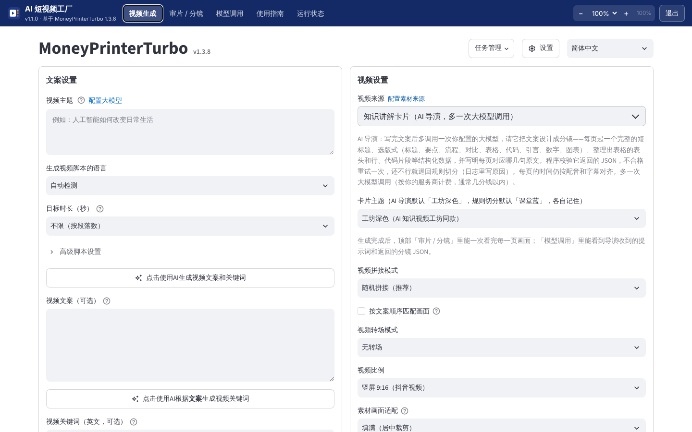

#### 2.4.1 库存视频（Pixabay、Pexels、Coverr）

```
文案 ──大模型──► 5–8 个英文搜索词 ──► 素材站搜索、下载片段（缓存在 storage/cache_videos）
                                         │
配音 ─► 字幕                              ▼
   └──────────────────► 处理片段（裁成统一画幅、截到「单个片段最大时长」）─► 拼接 ─► 最终渲染（MoviePy 叠字幕、混音）
```

- **钥匙**：素材站钥匙（Pixabay 推荐，免费，第 1.2 节）；大模型写文案、提关键词。**钱**：素材免费，大模型 2 次调用（文案、关键词）。
- **优点**：真实拍摄的画面，适合情绪、生活、风景、美食、旅行。**缺点**：画面和文案只在「主题词」层面相关，不是逐句对应；数字、公式、图表、代码、人名画不出来；外国面孔和场景居多；最终渲染慢（成片时长的 2–6 倍）。
- **和工坊**：工坊也能从 Pexels 搜图片，但只给 `category: concrete`（看得见、拍得到的具体事物）的镜头配图，其余镜头由程序画；本来源是每一段都用素材。
- **审片 / 分镜**：出片后按上游记下的素材清单，每段取一帧做缩略图，配上它的搜索关键词；起止时间是估算的（上游拼接时会裁切，随机拼接时顺序也不同），界面上标「约」。

#### 2.4.2 知识讲解卡片（规则切分）——1.0.2 起的方案，原样保留

```
文案 ─► 配音 ─► 字幕（每个词什么时候说）
              │
              ▼
程序按句末标点拆句 ─► 按字幕对上每句的开始/结束时间 ─► 按句式规则分页、选版式、用句子开头的主语或全文关键词当标题
              ─► Pillow 逐页画（要点随配音亮起、缓慢缩放平移）─► FFmpeg 一次合成画面、配音、字幕、背景音乐（快速通道）
```

- **钥匙**：不需要素材钥匙；文案你自己写的话连大模型也不需要。**钱**：不花（纯知识卡片也不提取关键词，比库存视频少 1 次调用）。
- **原理**：程序不「理解」内容，只看句子长什么样——「第一…第二…」做编号要点，「A…，而 B…」做对比两栏，「先…再…最后…」做流程箭头，「包括 A、B、C」做要点，带单位的数字做大数字卡（完整规则见第 2.4.6 节）。**标题**取句子开头的主语（「与门只有…」→「与门」）或全文出现最多的关键词。
- **优点**：完全离线、免费、稳定、快；画面上的字都来自你的文案，不会编造。**缺点**：标题有时是半截句子（1.0.3 用户实测出现「由这三种基本门」）；画不出表格、代码这类要先读懂内容才能整理出来的版式；句式不规整的文案大多落成关键词卡。
- **和工坊**：画法（版式、配色、排字）移植自工坊 `studio/visuals.py`；但工坊的分镜由大模型设计，这里由规则判断。

#### 2.4.3 知识讲解卡片（AI 导演）——1.1.0 新增

```
文案 ─► 配音 ─► 字幕
              │
              ▼
程序拆句、编号 [1] [2] … ─► 发给你配置的大模型（第 2 次调用，「导演」）：
    「把这些句子分成若干页，每页给：完整短标题、版式、结构化数据、对应的句子编号；只输出 JSON」
              │
              ▼
程序校验 JSON ──不合格──► 把原因告诉模型，重试 1 次 ──还不合格／调用出错──► 退回「规则切分」（日志写明原因）
     │合格
     ▼
每页时间 = 它对应的那几句在字幕里的开始到结束（和规则切分用同一套对时间的方法）
     ─► 工坊主题逐页画（表格逐行出现、要点逐条亮起、代码高亮…）─► FFmpeg 一次合成（同快速通道）
```

- **钥匙**：大模型（就是写文案用的那个，「设置 → 大模型设置」）。**钱**：多 1 次大模型调用。提示词约 1500–2500 个 token（固定说明约 1000 + 文案），输出约 500–1500 token；用 DeepSeek、通义千问这类国内模型通常不到 1 分钱，推理模型（带「思考」的）会多一些。导演不合格重试时再多 1 次。
- **导演收到什么**：固定的版式说明（标题、关键词、要点、流程、对比、表格、代码、引言、数字、图表各要哪些字段，每条多少字以内）、规则（每页 1–4 句、按顺序每句用一次、标题必须是完整短语、数据只能来自文案、相邻页别连续 3 次同一版式、竖屏字更少）、视频主题、画面方向（竖屏 / 横屏，按你选的视频比例）、编号的文案句子。原文在「模型调用」里能看到（第 2.9 节）。
- **程序校验什么**：能不能解析出 JSON；有没有 pages；每页的句子编号是不是整数、在范围内、连续、不和前面重复；有没有标题。这些不合格就重试。小毛病由程序修整、不重试，并写在「审片 / 分镜」顶部：标题超过 18 字截短、要点超过上限截掉、版式不认识或缺数据改成关键词卡、漏掉的句子并进前一页。
- **时间仍按配音对齐**：导演只决定「哪几句是一页、这页画什么」，不决定时间。每页从它第一句开口前（上一页结束）开始，到最后一句说完；表格的行、要点、流程节点：口播里明确提到某一条（字重合度高）就在那句开始时亮起，否则按句子进度匀速展开（照工坊的 `reveal_plan`）。
- **优点**：标题是完整短语；能出表格、代码、引言、图表；版式和内容匹配度高；仍然离线画图（只多一次文本调用），快。**缺点**：多一次调用（钱和十几秒到一两分钟的时间，看模型）；大模型可能编出文案里没有的「数据」（提示词禁止，程序也只能校验格式，**内容对不对要你在「审片」里看一眼**）；没配大模型或调用失败时会退回规则切分。
- **和工坊**：思路相同（让大模型先设计分镜，程序照着画），提示词照工坊 `prompts.py` 改写：改成中文版式说明、竖屏横屏都适用、只设计画面不改口播（工坊是一次调用连口播一起写）、用「句子编号」把每页和口播对上（工坊每镜自带 narration）、不要求作者观点和事实清单（那是工坊为发布平台的原创声明准备的）。

#### 2.4.4 工坊主题（「卡片主题」里的「工坊深色」）

把工坊 `studio/visuals.py` 的深色主题和全部版式完整移植过来（`svf_ext/studio_cards.py`）：深蓝渐变底、点阵和右上角圆弧、左侧强调色竖条的页标题、右上角页码；标题卡、关键词大字（双圆环）、要点逐条亮起（当前条加深并加左侧色条，已讲过的变暗）、流程箭头（讲到哪个节点哪个亮）、对比两栏（左蓝右橙）、表格（表头色块、逐行出现、当前行高亮）、代码（深色代码框、行号、关键字/字符串/数字/注释分色、强调行加橙色条）、引言（大引号）、关键数字、柱状/折线图。

- 「AI 导演」默认用它；「规则切分」也能选。主题是设置项，规则切分和 AI 导演各记各的；原来的课堂蓝、深夜蓝、暖纸三套保留。选浅色主题时遇到表格、代码这些新版式，也按工坊的画法、用该主题的颜色画。
- 和工坊的差别：版面避开你设置的字幕位置（工坊把字幕画在固定位置）；中文统一用随包的思源黑体（工坊找系统的微软雅黑 / 苹方）；代码用系统等宽字体（Menlo / Consolas / DejaVu），找不到时也用思源黑体；不画工坊的「AI 辅助制作」水印。

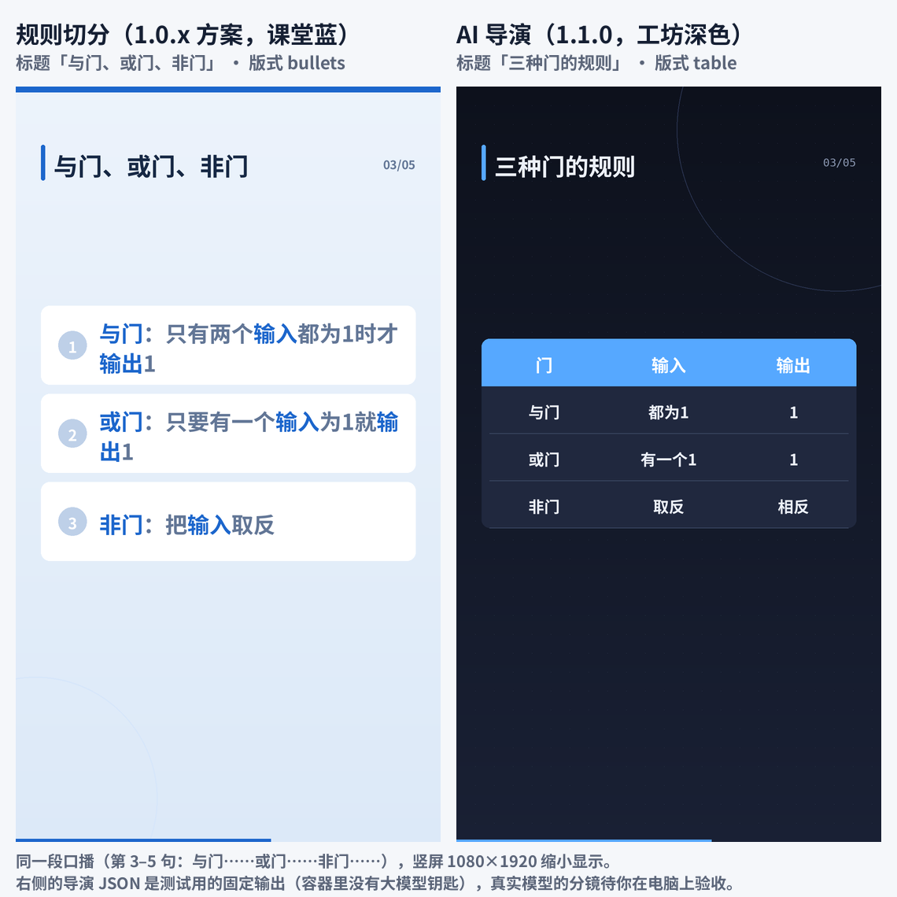

#### 2.4.5 知识讲解卡片 + AI 插图——1.1.0 新增

```
AI 导演（同 2.4.3，提示词多一条：「挑最多 3 页最适合配图的概念页，写英文画面描述 image_prompt」）
   │
   ├─ 没配置文生图 ─► 提示「需要先在 设置 → 素材来源设置 里配置文生图」，这次退回纯卡片（AI 导演照常）
   ▼
对标记的页逐张调用「OpenAI 兼容文生图」（POST 接口地址/images/generations）─► 图片存进任务目录 illustrations/
   ─► 这一页：插图铺满作背景，盖一层半透明的主题底色，再画版式；其余页照常由程序画
```

- **钥匙**：大模型 + 文生图（「设置 → 素材来源设置 → OpenAI 兼容文生图」的接口地址、模型、钥匙；本机的 ComfyUI / SD 网关可以不填钥匙）。**钱**：文生图按张计费，每个视频最多 3 张。
- **出错时**：某张没生成出来，这一页照常由程序画；请求「结果不明」（超时、连接中断，服务端可能已经扣费）时不再请求后面的图，避免重复计费（这是上游文生图函数自带的保护）。导演没用上（退回规则切分）时不配图。
- **优点**：概念页有画面，不只是字。**缺点**：花钱、慢（每张几秒到几十秒）；生成图可能有错字、怪手，内容是否合适要在「审片」里看；插图上盖了蒙版，色彩会变暗。
- **和工坊**：工坊给 `concrete` 镜头从 Pexels 搜**实拍照片**做 `image` 版式（照片放在内容区，左下角配说明）；这里用**文生图**、做**背景**。工坊的 `image` 版式也移植了，但导演提示词里没开放它。

#### 2.4.6 规则切分的细节、快速通道

（以下是 1.0.2、1.0.3 的说明，规则切分和 AI 导演共用后面几步。）

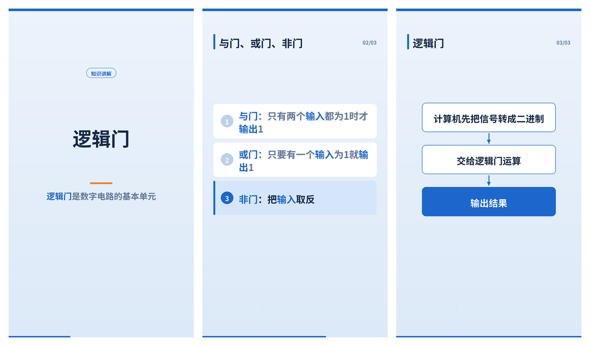

它怎样做画面：

1. **分页**：等配音和字幕生成好以后，按字幕时间把文案切成若干页（没开字幕时按每句的朗读长度估算）。太短的句子和下一句合成一页，避免一闪而过；最后一页一直放到配音结束。
2. **选版式**：按句子特征自动选，规则见下表。
3. **关键词高亮**：全文里引号/书名号中的词、英文缩写、每句的主语、主题、反复出现的词，在页面上用强调色（关键词卡的说明里还垫一条荧光笔底色）。
4. **要点逐条亮起**：编号要点、流程、对比的每一条，在配音说到它的时候才亮起来，当前这条加深强调。
5. **缓动**：每页缓慢放大（约 6%）、缩小或平移（约 4.5%），几种动作轮换；换页时 0.3 秒淡入。
6. **避开字幕**：字幕在底部时，页面内容放在上面约 78%（竖屏）/ 80%（横屏）；字幕在顶部时内容往下让；关掉字幕时用整个画面。字体是随应用提供的思源黑体。
7. **一次合成（1.0.3 快速通道）**：讲解页逐帧画好，字幕按 `subtitle.srt` 的时间直接画进画面（字体、颜色、描边、背景、位置都按你的「字幕设置」，默认随包的思源黑体，Windows 上不依赖系统字体），然后在**同一条 FFmpeg 命令**里读入配音和背景音乐（循环铺满、按音量混音、结尾 3 秒淡出），只编码一次就出成片 `final-1.mp4`。能用显卡的硬件编码器（NVIDIA `h264_nvenc`、Intel `h264_qsv`、AMD `h264_amf`、Mac `h264_videotoolbox`）时自动选用，先编 0.2 秒小样试一下，用不了或中途失败就改用软件编码 libx264。「单个片段最大时长」「片段播放速度」「视频转场」对这类来源不起作用（页与页之间是 0.3 秒淡入）；「同时生成视频数量」大于 1 时，讲解页内容是固定的，多出来的几条是同一个文件的副本。

**为什么以前慢**（1.0.2，你实测 51 秒竖屏视频最终渲染 5 分钟以上）：讲解页先编码成一段无声视频，再交回上游为库存素材设计的通用流程——「处理片段」把它裁切缩放后重新编码一次，「拼接」再过一遍 FFmpeg，「最终渲染」用 MoviePy 在 Python 里逐帧解码、把每条字幕画成图层叠上去、再编码一次，前后编码 4 次，最慢的是最后一步。快速通道把这些合并成一次。容器里（4 核 CPU、无显卡）用同一段约 47 秒的文案实测：1.0.2 流程 205–235 秒（两次实测；其中最终渲染约 160 秒），1.0.3 快速通道 33–40 秒，关掉缩放平移后 22 秒（详见 [02 软件框架与系统架构](<02 软件框架与系统架构.md>)「知识卡片快速通道」）。

万一快速通道的成片有问题，可以退回 1.0.2 的流程：退出应用，在数据目录的 `config.toml` 的 `[app]` 一节加一行 `svf_card_fast = false`；`svf_card_motion = false` 关掉每页的缩放平移（更快）；`svf_hw_encoder = "off"` 不用硬件编码器。选了 Sonilo / ElevenLabs 按画面现做背景音乐时，仍走上游流程（它们要先拿到一条合成好的画面）。

规则切分的版式规则：

| 句子特征 | 版式 | 例子 |
| --- | --- | --- |
| 第一句 | 标题页（主题 + 第一句的精简版） | 「逻辑门」 |
| 连续的「第一…第二…第三…」「首先…然后…最后…」 | 编号要点（前一句是「有三个要点：」这类引子时做标题） | 学习逻辑门有三个要点 ① 记住真值表 ② … |
| 主语同类的并列句 | 两句 → 对比两栏；三句以上 → 编号要点 | 「与门…。或门…。非门…。」 |
| 一句里有「先…再…最后…」「从 A 到 B」「A → B」 | 流程箭头（竖屏上下排，横屏左右排） | 信号转成二进制 → 逻辑门运算 → 输出结果 |
| 一句里有「…，而 / 但 / 相比之下…」 | 对比两栏 | CPU 有数十亿个晶体管，而早期计算机只有几千个电子管 |
| 「包括 A、B、C 和 D」 | 编号要点 | 与门、或门、非门、异或门 |
| 短句里有带单位的数字 | 关键数字 | 10亿次 |
| 其他 | 关键词卡（圆环里是这一页的关键词，下面一句精简说明）或文字卡 | CPU |

#### 2.4.7 混合（Pixabay / Pexels + 知识卡片补齐）

```
文案 ─► 关键词 ─► 搜索、下载素材 ──够覆盖整条配音──► 和库存视频一样
                        │不够 / 搜不到 / 没钥匙 / 网络不通
                        ▼
              按「补齐用的卡片」（规则切分或 AI 导演）分页 ─► 下到的素材放进普通讲解页（关键词卡、文字卡），其余页画卡片
```

- **钥匙**：素材站钥匙（不填也行，全部用卡片补）；补齐用 AI 导演时要大模型。**钱**：同库存视频；补齐用 AI 导演时多 1 次调用。
- 不会因为搜不到素材而失败；日志里写「混合来源：Pixabay 找到 N 段素材……用知识卡片补齐」和搜不到的原因。标题、要点、对比、流程、数字、表格这些有结构的页仍用卡片。
- **和工坊**：工坊是「先分镜、再给 concrete 镜头配图」；混合是「先搜素材、不够再画卡片」，素材优先。

#### 2.4.8 AI 视频、OpenAI 兼容文生图、本地文件（上游自带，本应用没改）

```
AI 视频：  文案 ─► 关键词 ─► 逐个关键词请视频生成服务现做片段（按秒或按条计费），凑够配音时长就停 ─► 处理片段 ─► 拼接 ─► 最终渲染
文生图：   文案 ─► 关键词 ─► 逐个关键词生成一张图（按张计费）─► 每张做成「缓慢放大」的片段 ─► 同上
本地文件： 你上传的视频 / 图片 ─► 同上
```

- **AI 视频**（秘塔 / MiniMax、OFox、LoomLoom、火山 Seedance、WaveSpeed、MuAPI）：需要各家的钥匙，价格在界面上有标注，通常一条视频几元到几十元；画面现做、和关键词相关，但慢、贵、风格难统一、可能有怪异画面。本应用没有用真实钥匙验证过。
- **OpenAI 兼容文生图**（上游的「AI 生图」组）：和「卡片 + AI 插图」用的是**同一组设置、同一个上游函数**；区别是它给每个关键词都生成一张图、整条视频都是图，而插图模式只给导演挑的最多 3 页配图、其余页是卡片。
- **本地文件**：适合你自己拍的素材；不要钥匙、不花钱。
- **和工坊**：工坊没有这几种来源。
- **审片 / 分镜**：这三种来源 1.1.0 暂不支持（界面上会说明）。

#### 2.4.9 怎么选

| 主题 | 推荐来源 | 原因 |
| --- | --- | --- |
| 概念、原理、步骤（逻辑门、光合作用、TCP 三次握手） | 知识讲解卡片（AI 导演）；不想多花一次调用就用规则切分 | 素材库里搜不到对应画面；导演能整理出表格、流程、对比，标题完整 |
| 有数字、对比、清单、代码的内容（利率、榜单、参数对比、编程入门） | 知识讲解卡片（AI 导演） | 表格、代码、图表只有导演能整理出来；规则切分只能做要点和数字卡 |
| 有具体事物、需要一点画面感的知识（芯片长什么样、火山怎样喷发） | 知识讲解卡片 + AI 插图 | 少数页配图，其余仍是准确的文字讲解 |
| 情绪、励志、生活方式、旅行风景、美食 | Pixabay（库存视频） | 实拍画面好看，不需要精确信息 |
| 泛科普（为什么夏天容易犯困） | 混合 | 能搜到合适实拍就用，搜不到的部分用卡片讲清楚 |
| 外语短视频 | Pixabay；或知识讲解卡片（AI 导演） | 规则切分按中文句式调过，英文效果一般；导演不依赖句式 |

### 2.5 素材下载代理（1.0.2 新增）

有的网络要开代理才能访问 Pixabay / Pexels。以前只能开系统代理（会让所有软件都走代理）或手改 `config.toml`。现在：「设置 → 素材来源设置」→ 最底下「**素材下载代理（可选，如 http://127.0.0.1:7897）**」，填你的代理软件提供的本机 HTTP 代理地址（常见端口 7890、7897、1080 等，以代理软件里显示的为准；`socks5://` 开头的 SOCKS 代理也可以）。

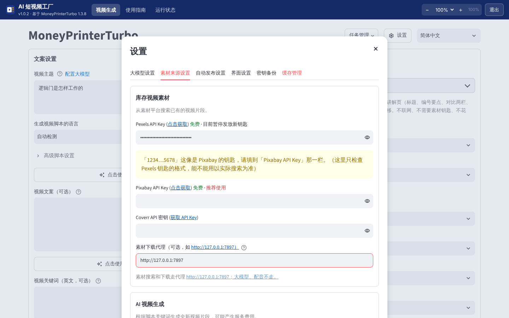

- 填了以后**立即生效**，只有素材搜索和下载走这个代理（Pexels、Pixabay、Coverr，以及上游接入的 AI 视频服务的接口）；大模型、Edge 配音不走它，不用开系统代理。
- 格式不对时输入框下面会提示；留空表示不用代理。
- 保存在 `config.toml` 的 `[proxy]` 一节（http、https 两项设成同一个地址），这是上游本来就有的设置项。

### 2.6 各来源适合什么主题

见第 2.4.9 节「怎么选」。

### 2.7 防止重复提交、取消任务、已中断（1.0.3）

**为什么要防**：1.0.2 里连按三次「生成视频」会同时起 3 个任务；而且连点时有的点击还没真正提交就被下一次点击打断，留下永远显示「生成中 0%」的记录，删除按钮是灰的，删不掉也停不下来。1.0.3：

- **按钮置灰**：有任务在生成（或排队）时，「生成视频」变成灰色的「**生成中…**」，下面写着「已有任务在生成（进度 x%）……」。生成结束后自动恢复。
- **连点无效**：点一下以后 4 秒内再点不会生效（页面脚本拦下）；后台提交前还会再检查一次，同时到达的几次点击只放行一个，其余显示「已有任务在生成，这次点击没有新建任务」；同一个窗口、同样的参数 90 秒内重复提交，只保留第一个（提示「同样的参数 N 秒前刚提交过」）。
- **取消**：打开「任务管理」，生成中的那一行最右边是 ⏹「**取消**」（原来灰色的删除按钮的位置），列表上方写着「生成中的任务不能直接删除：先点 ⏹ 取消」。点了以后：状态立即变成「**已取消**」，这个任务正在跑的 FFmpeg 子进程被结束，后台在当前这一步结束时停下（正在等一次网络请求时，要等它返回）。取消后删除按钮就能点了。排队还没开始的任务，取消后不会再开始。
- **已中断**：状态是「生成中」、但后台其实已经没有在跑的任务（连点时没真正提交的、程序重启或崩溃前没跑完的），打开「任务管理」时会被认出来，标成「**已中断**」，归到「失败」标签页，可以删除。任务文件夹里的 `svf_status.json` 记着它由哪个后台进程在跑，所以重启应用以后也认得出来。你手上 1.0.2 留下的那几个「生成中 0%」，升级后打开任务管理就会变成「已中断」或消失（它们本来就没有提交），可以删除。

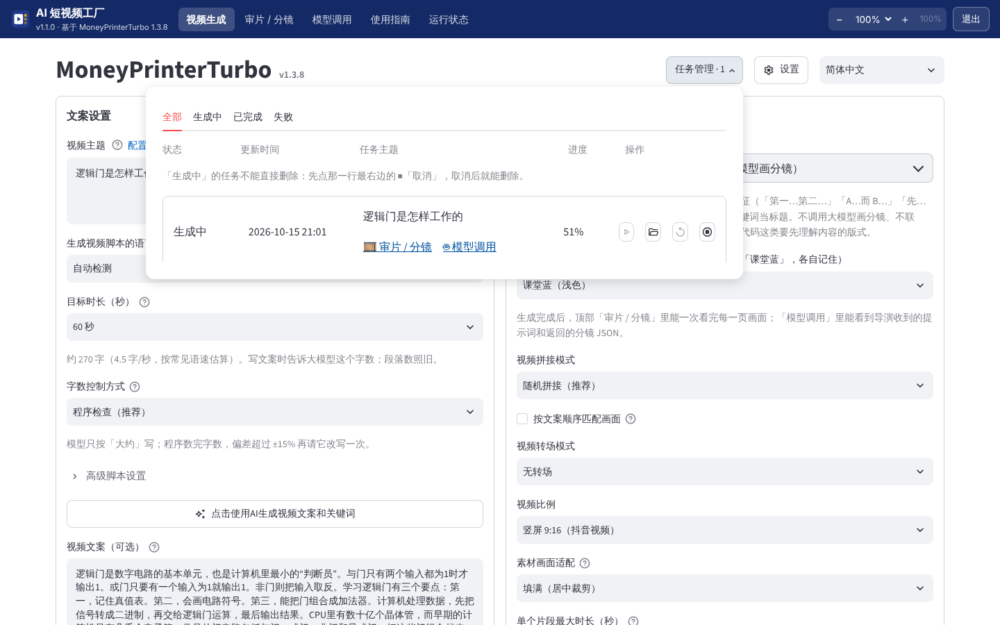

### 2.8 日志解读（1.0.3）

生成按钮下方，原始日志的上面多了「**日志解读**」（默认展开），按 8 个步骤用中文讲当前在做什么：**写文案 → 提取关键词 → 配音 → 字幕 → 找素材或画卡片 → 处理片段 → 拼接 → 最终渲染**。

- 最上面一行是现在的状态：「现在：最终渲染（这一步已用 120 秒）。……」，完成、失败、已取消时分别说明；失败时说是在哪一步、原因是什么。
- 每一步：✅ 完成 / ⏳ 进行中 / ❌ 失败 / ⏭️ 跳过 / ▫️ 还没开始，开始时间、用时、**原始日志第几行起**；展开写四件事：**在做什么、为什么要做、正常要多久、出错通常是因为什么**；下面列出这一步里值得注意的日志，每条都带「第 N 行 · 时间」，能对照到原始日志（原始日志 1.0.3 起左边带行号）。
- 「final video render still running: elapsed=60s」这种行是「还在运行」的报平安，解读成「仍在渲染，已用 60 秒」，不是出错。
- 知识讲解卡片不提取关键词、快速通道没有「处理片段」「拼接」，这些步骤显示「跳过」。
- 「配音」一步里显示**目标时长和实际配音时长**（第 2.10 节）；「写文案」一步里显示**字数控制方式、目标字数和实际字数**（第 2.11 节）。
- 1.1.0：「找素材或画卡片」一步里显示 AI 导演的进展（「请大模型把文案设计成分镜」「分镜通过校验（第 1 次），5 页」或「没有用上（原因），退回规则切分」）、AI 插图的结果、分镜画面存在哪里。

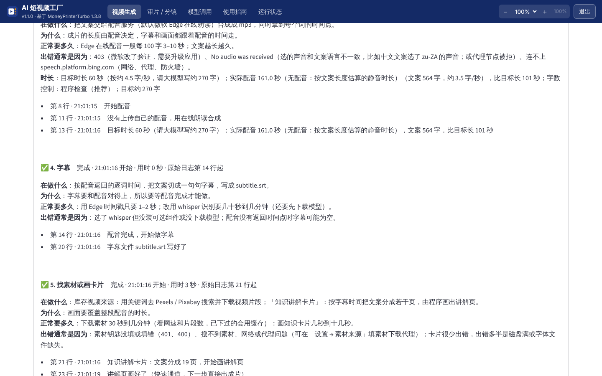

### 2.9 「模型调用」标签页（1.1.0；1.0.3 的「大模型调用记录」搬到这里）

1.0.3 把调用记录放在生成页的日志上方，生成页本来就很长，1.1.0 把它搬到顶栏的「**模型调用**」，生成页只留一个链接。打开后先在顶部选任务（默认最新一个调用过大模型的），下面按时间顺序列出这个任务的每一次大模型调用。每次调用是一块，用中文标明「谁说的」：

| 块 | 是谁说的 | 显示什么 |
| --- | --- | --- |
| ① 程序发给模型的 | 本应用（上游 + 外壳）→ 模型 | 每条消息原样显示，标明 `role`（`system` 系统提示 / `user` 用户消息），和真正发出去的一字不差。**颜色**：普通文字是**固定模板**（程序每次都发的说明）；黄色底是**程序填进去的变量**（你的主题、段落数、目标字数、编号的文案句子……），前面的小标签写着变量名；蓝色底是**程序按设置加的整段要求**（例如按目标时长换算的字数要求）；**绿色下划线**是「**上一次调用的输出**」出现在这次输入里的地方，标着「来自 #N 的输出」 |
| ② 模型的思考过程 | 模型 | 推理模型（DeepSeek R1、带「思考」的千问等）在正式回答前写的思考，接口字段是 `reasoning_content`（或正文里的 `<think>…</think>`）。默认收起；这次没有就写「没有」 |
| ③ 模型返回的内容 | 模型 | 正式回答的原文（上游整理之前） |
| ④ 程序最后怎么用它 | 本应用 | 例如「取作视频文案（262 字）……」「解析成搜索关键词列表 [...]」「解析成分镜 JSON：5 页（标题、要点、表格、代码、流程）」「校验没通过：……重试一次」「没有采用：……退回规则切分」。失败的调用写「这次调用失败了……上游会再试一次」 |
| ⑤ 用量和耗时（灰色小字） | 接口 | 服务和模型、接口地址、耗时、token：输入 / 输出（其中思考多少）/ 合计 |
| ⑥ 查看原始数据 | — | 整条记录的 JSON（含接口返回的原始应答），默认收起 |

- **调用链**：每块顶部写「↖ 这次的输入里用到了 #1 的输出（262 字）」，底部写「↓ 这次的输出进了 #2 的输入」，点了跳过去。程序是这样找的：把前面每次调用的输出按句子切开，逐句在后面调用的输入里查找，找到的连成一段标绿；没被采用的输出（例如「按字数改写」改完没有更接近目标、程序没用它）不算来源。
- **长文本**：超过 6000 字的块默认收起，点标题展开；每块右上角有「**复制**」。
- **没有 API Key**：记录里绝不出现钥匙（写入前就去掉了，见下面）。

**一条例子，逐段解读**（下面的提示词是本应用真实发出去的原文；容器里没有大模型钥匙，**模型的回答是测试用的假服务返回的固定内容**，真实模型的回答待你在电脑上看）。主题「逻辑门是怎样工作的」、目标时长 60 秒、字数控制「程序检查」，先在界面上点「生成文案和关键词」，再选「知识讲解卡片（AI 导演）」生成视频。这个任务有 4 次调用：

1. **#1 写文案**。① 程序发的 `role: user` 消息：前面一大段英文是上游 MoneyPrinterTurbo 的**固定模板**（`# Role: Video Script Generator` …「不要用 Markdown、不要提到提示词本身、用和主题一样的语言写」）；`# Initialization:` 下面 `- video subject:` 后面的「逻辑门是怎样工作的」和 `- number of paragraphs:` 后面的「1」是**黄色变量**；最后的 `# Length Requirement:`（「配音约 60 秒，大约 270 个汉字，不需要逐字计数，程序之后会检查」）是**蓝色的程序加的要求**。③ 模型返回约 600 字的文案。④ 程序：「程序数了字数：这次写了 6xx 字，目标约 270 字，偏差超过 ±15%，所以请模型改写了一次（见下一次调用），最终用的是改写后的文案」。
2. **#2 按字数改写文案**。① 「下面是一段短视频口播文案，当前约 **6xx** 字。请把它**缩写**到约 **270** 字……只输出改写后的文案。文案：」是模板，黄色的是程序数出的字数、扩写还是缩写、目标字数；后面整段文案带绿色下划线「来自 #1 的输出」。③ 缩写后的文案。④「取作改写后的文案：6xx → 2xx 字（目标约 270）。之后的配音、字幕、画面都用它。」
3. **#3 提取关键词**（界面上「生成文案和关键词」按钮顺带做的；AI 导演卡片其实用不到关键词）。① 上游的英文模板「# Role: Video Search Terms Generator …只返回 JSON 字符串数组」，`### Video Script` 下面的文案带绿色下划线「来自 #2 的输出」——说明进关键词提示词的是改写后的文案。③ `["logic gate", "circuit"]`。④「解析成搜索关键词列表 [...]，拿去素材站搜视频。」
4. **#4 AI 导演设计分镜**。① 中文**模板**「你是知识类短视频的分镜导演……版式 type 与 data 字段……规则……输出 JSON 结构」；**变量**：视频主题、画面方向「竖屏 9:16」、句子数、**编号的文案句子** `[1] 逻辑门是数字电路的基本单元…… [2] ……`（绿色下划线「来自 #2 的输出」）。② 思考过程：「共 7 句。第 1 句开场用标题；第 3–5 句讲三种门的规则，适合做成表格……」。③ 一段 JSON：`{"title": …, "pages": [{"sentences": [1], "type": "title", "heading": "逻辑门是什么", …}, {"sentences": [2, 3], "type": "bullets", …}, …]}`。④「解析成分镜 JSON：4 页（标题、要点、表格、流程）。每页的时间按这一页对应的句子和字幕对齐。」——再去「审片 / 分镜」就能看到这 4 页。

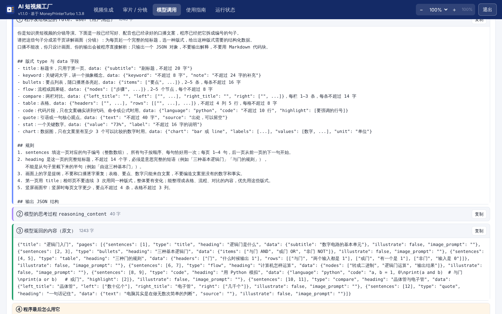

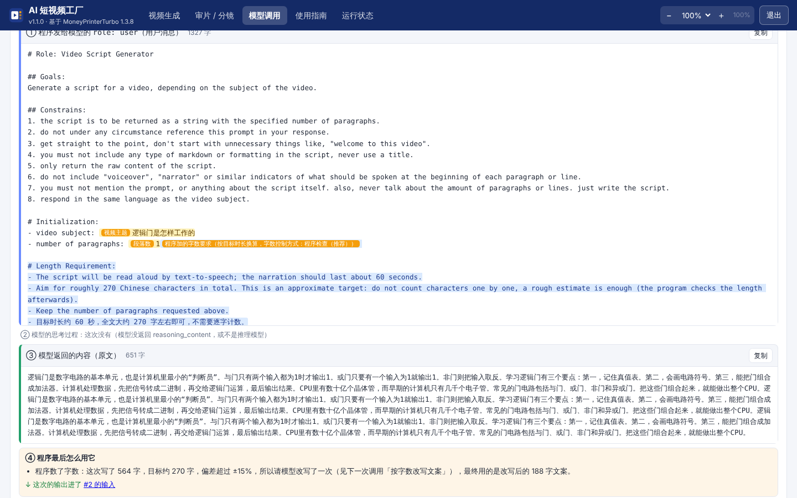

**记录存在哪**：任务文件夹的 `llm_calls.jsonl`（一行一次调用，JSON 格式，可以用文本编辑器打开；1.1.0 起每行还有 `parts`——提示词按模板 / 变量切开的片段、`reasoning`——思考过程，另有 `{"kind": "use"}` 行记「程序怎么用」）。**记录里绝不会出现 API Key**：不记配置；写入前会把配置里所有钥匙、令牌的值，以及 `sk-…`、`Bearer …` 这类串换成 `***`。

先在界面上点「点击使用AI生成视频文案和关键词」、再点「生成视频」时：那几次调用发生在任务开始之前，先记在数据目录 `storage/llm_calls/webui.jsonl`，提交任务时如果用的就是这段文案（或它按字数改写后的样子），会复制进这个任务的记录里，标着「在界面上点「生成文案」时调用的」。自己写文案、又选「规则切分」知识卡片时，整个任务不调用大模型，这里显示「这个任务没有调用大模型」。

### 2.10 目标时长（1.0.3）

「文案设置」里「生成视频脚本的语言」下面是「**目标时长（秒）**」：不限（按段落数）、30、60、90、120 秒，或「自定义…」（10–600 秒）。

- 换算：中文按每秒约 4.5 个字（不算标点），英文按每秒约 2.6 个词，再乘以「配音语速」（1.2 倍语速就按每秒 5.4 字算）；下面会显示「约 270 字（4.5 字/秒，按常见语速估算）」。每出一条有配音的视频，应用会记下「实际字数 ÷ 实际配音秒数」（数据目录 `storage/svf_speech_rate.json`），以后用最近几次的中位数，越用越准（无配音、上传自己配音的任务不算）。
- 写文案时在提示词末尾加上字数要求，怎么写取决于「字数控制方式」（第 2.11 节）：严格档是「配音要持续约 60 秒，全文约 270 个汉字（243–297）」，默认的程序检查档是「大约 270 个汉字，不需要逐字计数」。上游的「段落数」仍然有效：段落数决定结构，字数决定长度。
- 生成后「日志解读」的「配音」一步显示「目标时长 60 秒；实际配音 58.2 秒，文案 262 字，比目标短 2 秒」。大模型不一定严格按字数写；「程序检查」档偏差超过 ±15% 会自动请它改写一次。
- 自己在「视频文案」里写好文案时，不会改写你的文案，只显示目标和实际时长做对照。

### 2.11 字数控制方式（1.1.0）

选了目标时长后，「目标时长（秒）」下面有「**字数控制方式**」，三档：

| 档位 | 提示词里怎么写 | 字数准不准 | 成本和速度 |
| --- | --- | --- | --- |
| **让大模型自己数（严格）** | 1.0.3 的做法：「全文约 270 个汉字（243–297 之间，不算标点）」 | 最准，多数一次就落在区间里 | **思考 token 多、慢、贵**：推理模型会在思考里逐字数数、写了删、删了数。1.0.3 你实测的那次调用，1668 个输出 token 里 1482 个花在思考（数字数）上 |
| **程序检查（推荐，默认）** | 「大约 270 个汉字，不需要逐字计数，程序之后会检查」 | 第一次可能偏差 10%–30%；程序数完字数，偏差超过 **±15%** 时再请模型「当前 X 字，请扩写 / 缩写到约 Y 字」改一次，改完更接近目标才采用 | 第一次调用的思考少很多；偏差大时多 1 次调用（这次只改写，不用从头想内容）。总体通常比严格档便宜、快 |
| **不控制（只按段落数）** | 不提字数，只有上游的段落数 | 看模型发挥，视频长短不可控 | 最省 |

- **对内容质量的影响**：目前**没有证据表明逐字计数会让内容更好**——数字数占用的是思考预算，不是在想内容；但也没有做过对比实验（容器里没有大模型钥匙），以你实测为准。可以用同一个主题、三档各生成一次，在「模型调用」里对比思考过程的长短、输出 token 和内容。
- **在哪看结果**：「日志解读」的「写文案」一步和顶部摘要里显示「字数控制：程序检查（推荐）；目标约 270 字，模型写了 180 字（-33%），偏差超过 ±15%，请模型改写了一次 → 262 字」；「模型调用」顶部也写着所用档位、目标和实际字数。
- 自己写好文案时不改写你的文案，三档都只做对照。

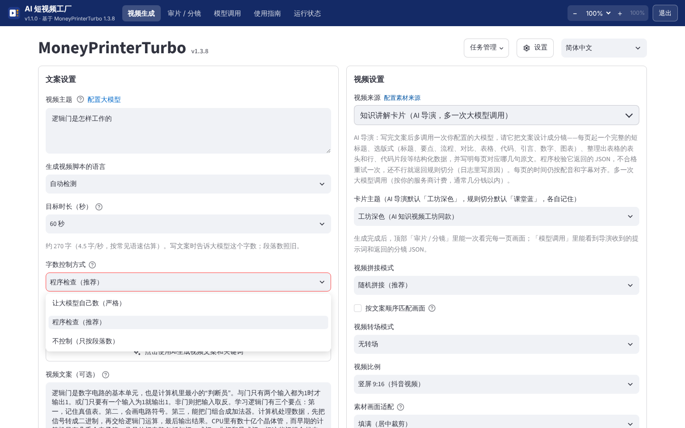

### 2.12 「审片 / 分镜」：生成完以后一次看完每一页（1.1.0）

一键生成的流程不变（**生成前不需要审核**）。生成完成后，生成页的「🎞️ 审片 / 分镜」链接、任务管理里每个任务主题下面的同名链接，或者直接点顶栏「**审片 / 分镜**」再选任务，都能打开。顶部写着这个任务的来源、分镜是「AI 导演设计的」还是「规则切分」（AI 导演没用上时写原因）、页数、主题、画面尺寸。有两个视图：

**审片（总览）**——照工坊「审片」页的排版，用来**一次扫完所有画面**，最常用：

- 左边是成片播放器，右边一屏铺开多列缩略图网格；每格：画面缩略图、**序号和版式名**（如「3 · 表格」）、起止时间、标题、这一页的**口播文字**。
- **点一格，成片跳到那一页的时间开始播放**；播放时当前页的格子会高亮。每格右上角「详情 ›」打开这一页的分镜详情。

**分镜（逐镜详情）**——照工坊「分镜」页的排版，用来**细看某一页**：

- 左边是分镜列表（序号、版式、标题），右边是选中那一镜：**大图预览**、画面类型、标题、副标题（标题页）、**口播原文和字数**、时长、起止时间、对应的原文句子编号（AI 导演）、要点逐条亮起的时间、AI 插图，以及**导演给的结构化数据**（表格画成表格、代码原样显示、要点、流程、对比两栏、引言、数字、图表数据）；「原始数据（JSON）」可展开。
- 「▶ 在成片里从这一页播放」回到审片视图并从这一页开始播；「上一镜 / 下一镜」翻页。1.1.0 只读，不能在这里改了重新合成。

**支持哪些来源**：程序生成组（规则切分、AI 导演、卡片 + AI 插图、混合）和库存视频（Pexels、Pixabay、Coverr）。库存视频每段素材取一帧做缩略图，配上它的搜索关键词，起止时间是估算的（标「约」）。AI 视频、OpenAI 兼容文生图、本地文件来源，以及 1.1.0 以前生成的任务，这里会说明「这个任务没有分镜清单」。

**和工坊的区别**：工坊的审片 / 分镜在**生成之前**，用来审核和修改（改口播、换版式、重新配图）后再渲染；这里在**生成之后**，只看不改，目的是快速检查画面、对照口播。

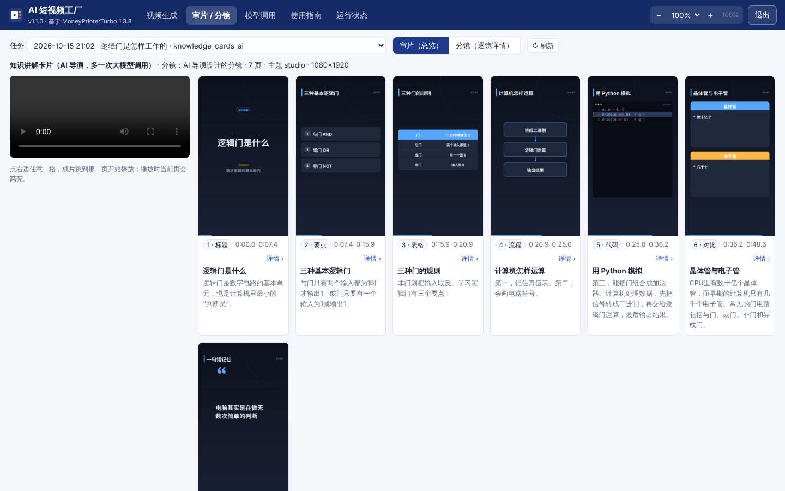

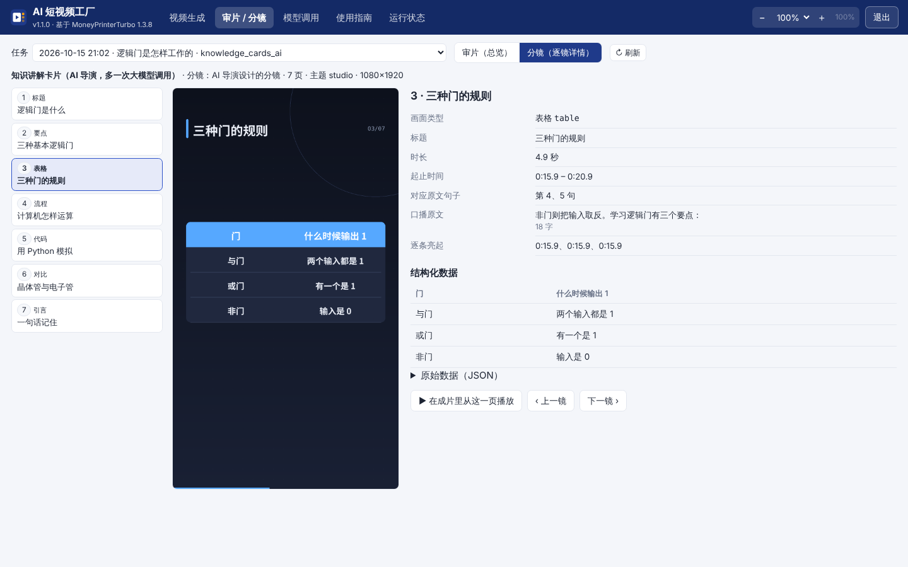

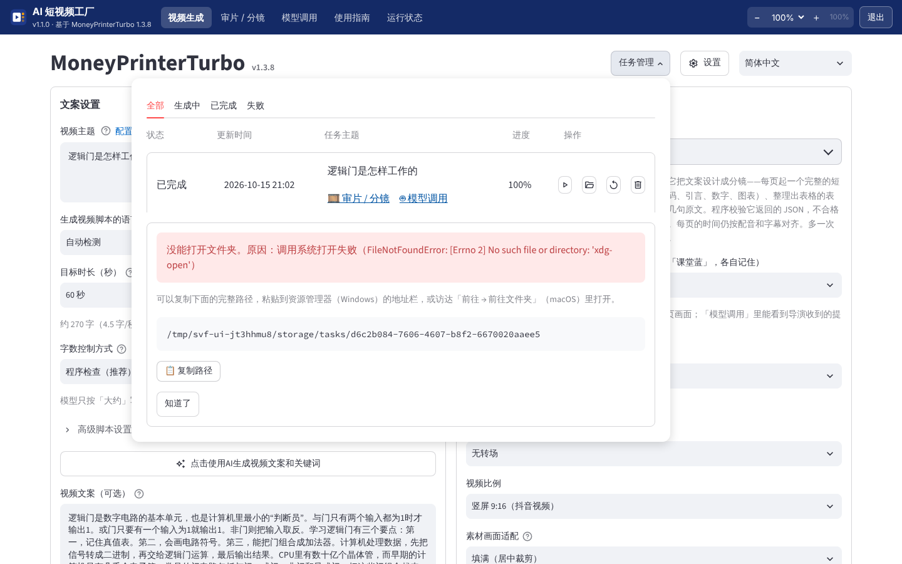

## 3. 数据从哪来、存在哪、何时更新

| 数据 | 来源 | 何时产生 / 更新 | 存在哪 |
| --- | --- | --- | --- |
| 文案、关键词 | 你选的大模型 | 点「生成文案和关键词」或「生成视频」时，各调用 1 次 | 任务文件夹 `script.json` |
| 大模型调用记录 | 应用在每次调用大模型时记下（不含 API Key） | 每次调用 | 任务文件夹 `llm_calls.jsonl`；没有任务的调用在 `storage/llm_calls/webui.jsonl` |
| AI 导演的分镜 | 你选的大模型（多 1 次调用） | 生成视频时，配音和字幕完成后 | 原文在 `llm_calls.jsonl`；整理后的分镜在 `svf_storyboard.json`、`knowledge-cards/storyboard.json` |
| AI 插图 | 你配置的 OpenAI 兼容文生图服务 | 生成视频时，导演标记的页（最多 3 张） | 任务文件夹 `illustrations/` |
| 分镜画面（审片 / 分镜用） | 本机程序画出每页的完整画面；库存视频取每段素材的一帧 | 卡片类：素材这一步；库存视频：出片后 | 任务文件夹 `knowledge-cards/page-NN.png`、`thumb-NN.jpg`，清单 `svf_storyboard.json` |
| 字数控制结果 | 程序数的字数 | 写文案后 | 任务文件夹 `svf_task.json`（`length_mode`、`target_chars`、`first_chars`、`final_chars`、`revised`） |
| 目标时长、实际时长、实测语速 | 你选的目标时长；配音完成后量出的实际时长 | 提交任务时、配音完成时 | 任务文件夹 `svf_task.json`；`storage/svf_speech_rate.json` |
| 视频素材 | Pixabay / Pexels / Coverr 按英文关键词搜索后下载（填了「素材下载代理」时经代理） | 生成视频时 | 素材缓存 `storage/cache_videos/`（下次同样关键词可复用，「设置 → 缓存管理」可清理） |
| 知识讲解卡片画面 | 本机程序按文案和字幕时间画出（不联网） | 生成视频时，配音和字幕完成后 | 任务文件夹 `final-1.mp4`（快速通道直接出成片）、`knowledge-cards/` |
| 配音 | Edge TTS（微软在线语音，免费）或你配置的其他 TTS | 生成视频时 | 任务文件夹 `audio.mp3` |
| 字幕时间轴 | 默认用 Edge TTS 返回的逐词时间戳 | 生成视频时 | 任务文件夹 `subtitle.srt` |
| 背景音乐 | 你放进 `songs/` 的 mp3 | 生成时随机挑一首（或指定） | `songs/` |
| 设置与 API Key | 你在界面里填写 | 改动后立即保存 | `config.toml`（卡片主题在 `[app]` 的 `svf_card_theme`（规则切分）和 `svf_ai_card_theme`（AI 导演），混合补齐用的卡片 `svf_hybrid_card_mode`，文生图 `openai_image_*`，字数控制方式在 `[ui]` 的 `svf_length_mode`，素材下载代理在 `[proxy]`） |

数据目录：macOS `~/Library/Application Support/ShortVideoFactory/`，Windows `%LOCALAPPDATA%\ShortVideoFactory\`。里面：

```
config.toml        上游的设置文件（大模型、素材、配音的 Key 都在这里，请勿外传）
storage/tasks/     生成的视频（每个任务一个文件夹）
storage/cache_*    素材搜索与下载缓存
fonts/             字幕字体（随应用提供的开源字体 + 你自己放的字体）
songs/             背景音乐（你自己放）
logs/              launcher.log（外壳）、webui.log（生成界面后台）
shell.json         外壳设置（缩放档位、上次打开的栏目）
webview/           窗口的浏览器缓存
```

数据目录不在安装目录里，升级、重装、卸载都不会删。想彻底清除，退出应用后手动删除这个文件夹。

## 4. 结果怎么理解

**一条视频花多少钱**：库存视频默认调用大模型 **2 次**（文案 1 次 + 搜索关键词 1 次，失败会自动重试最多 5 次）；知识讲解卡片（规则切分）只有写文案 1 次；**AI 导演再加 1 次**（导演输出不合格时再加 1 次重试）；**字数控制「程序检查」**在偏差超过 ±15% 时加 1 次改写；**卡片 + AI 插图**另有文生图最多 3 张（按张计费，看服务商）。一条 1 分钟视频的文案约 300–400 字，两次调用合计大约 1500–3000 token，用 DeepSeek、通义千问这类国内模型通常不到 1 分钱，用 GPT / Claude 级别的模型也就几分钱。Pexels、Pixabay、Edge TTS 免费。界面上不显示花费，以服务商控制台的账单为准。如果开了「自动发布」（Upload-Post），每次发布还会多 1 次调用生成标题和标签。

**知识讲解卡片（规则切分）的画面**：页面上的字都来自你的文案，由程序排版，不会出现文案里没有的内容，数字也不会画错；但「这句话该用什么版式、哪个词是关键词、要点怎么缩短」是按句式规则判断的（不调用大模型），偶尔会把普通句子当成对比、把要点截得不完整（超长的会以「…」结尾），标题可能是半截句子。

**AI 导演的画面**：标题、版式、表格内容由大模型整理，通常更像「讲解页」；但它是大模型写的，**可能把文案里没有的说法或数字放进表格、要点**（提示词禁止编造，程序只校验格式、不校验事实），发布前请在「审片」里扫一遍。每页的时间仍由程序按配音和字幕对齐，导演改不了。想要更好的版式，文案里多用「第一…第二…」「先…再…最后…」「A…，而 B…」「包括 A、B、C」这类清楚的句式；分页结果和每页图片都在任务文件夹 `knowledge-cards/` 里，可以检查。画面没有照片和插图，视觉冲击力不如实拍。

**库存视频的画面和文字的关系**：画面是按英文关键词从素材库里搜来的实拍片段，和文案只在「主题词」层面相关，不是逐句对应；可能出现画面和这句话说的事对不上、同一个片段风格不统一、外国面孔和场景居多的情况。勾选「按文案顺序匹配画面」会让关键词按文案顺序生成、素材按顺序拼接，对得更准一些。数字、公式、图表、代码、人名这类内容**画不出来**——素材库里没有，这类题材用「知识讲解卡片」，或见 [04 对比](<04 与AI知识视频工坊的对比.md>)。

**文案准确性**：文案完全由大模型根据主题写成，没有参考资料输入、没有事实核对环节，可能有事实错误或过时信息，发布前请自己核对。

**配音和字幕**：Edge TTS 的中文声音自然度不错；字幕按逐词时间戳断句，和配音同步。多音字、英文缩写可能读错，可在文案里改写（如把「GPU」写成「G P U」）。

**已知限制和没验证的**：

- 本应用在 Linux 容器里验证了界面、接口和进程管理；**没有用真实 Key 跑通出片**（容器里没有 Key），真实出片待你在电脑上验收。
- Whisper 字幕模式需要额外组件，默认不提供（见第 5 节「可选组件」）。
- Edge TTS 是微软的在线服务，非官方接口，可能限流或变动（2026-10 改过一次验证，见第 5 节「配音失败（403）」）；商用授权没有明确说法。
- 1.0.1 换用的 edge-tts 7.3.1：容器里连不上微软服务器，只验证了上游配音调用在新版本下接口不报错（通信层换成假服务端走完整条路径）；**真实配音待你在电脑上验收**。
- 「自动发布」（Upload-Post）是上游功能，本应用没有验证；各平台对自动化发布有限制，请谨慎使用。
- 1.0.2 的知识讲解卡片：容器里用固定文案和假配音（本地生成的音频 + 逐字时间）离线跑通了上游完整流水线、产出了 1080×1920 成片，CI 两个平台的冒烟测试也用安装包里的 Python 跑同一个任务；**用真实大模型文案 + Edge 配音出片的效果待你在电脑上验收**。混合来源在「没有钥匙 → 全部用卡片补齐」这条路径上验证过；「搜到部分素材 → 和卡片混排」只做了单元测试，没有用真实 Pixabay 钥匙跑过。
- 1.0.2 的「打开目录」：容器里验证了三个平台各走哪条分支（单元测试）；Windows 上实际弹出资源管理器待你验收。素材下载代理只验证了写入配置，没有接真实代理。
- 1.0.3 的「打开目录」改由应用主进程打开：容器里验证了接口的路径限制（数据目录外、符号链接指到外面、不存在的路径都被拒绝）、子进程经接口请求、打开失败时界面显示完整路径和「复制路径」；**Windows 上资源管理器窗口真的弹到前面，只有在你的电脑上才能确认，待验收**。
- 1.0.3 的知识卡片快速通道：容器里（Linux、无显卡）实测了软件编码 libx264 的用时和成片（字幕和配音同步、背景音乐铺满并淡出、1080×1920）；**硬件编码器（NVIDIA / Intel / AMD / Apple）是否被选用、用时多少，只有在有显卡的电脑上才能确认**，CI 的 Windows / macOS 机器上冒烟测试会跑一次快速通道。日志解读里会写「编码器 h264_xxx（硬件编码）」或「libx264（软件编码）」。
- 1.1.0 的 AI 导演、AI 插图：容器里没有大模型和文生图钥匙，用**假的 OpenAI 兼容服务端**（返回固定的导演 JSON 和一张 PNG）离线跑通了出片、重试、退回规则切分、插图、分镜图；**真实大模型设计的分镜效果、真实文生图的效果和费用，待你在电脑上验收**。不同大模型遵守 JSON 格式的程度不同，小模型、本地模型更容易不合格而退回规则切分。
- 1.1.0 的「字数控制方式」：三档提示词、程序数字数、偏差超过 ±15% 时改写一次，都在假服务端上验证过；「程序检查」比「严格」省多少思考 token、对内容质量有没有影响，**没有用真实推理模型对比过**，以你实测为准。
- 1.1.0 的「审片 / 分镜」：卡片类来源在容器里验证过（网格、点一格跳转、分镜详情、结构化数据）；**库存视频来源的缩略帧只做了单元测试和代码走查，没有用真实素材钥匙跑过**；起止时间是估算的。
- 1.0.3 的取消：容器里验证了取消正在编码的任务（FFmpeg 被结束、状态是「已取消」、之后不会被写回、可以删除）；正在等网络请求（配音、下载素材、大模型）时取消，要等这次请求返回后才停下。

## 5. 出了问题怎么办

先看「运行状态」页：生成界面后台的状态、错误信息；再看数据目录 `logs/` 里的 `webui.log`（生成过程的详细日志）和 `launcher.log`（窗口和后台的启停）。

| 现象 | 可能原因 | 怎么办 |
| --- | --- | --- |
| 一直显示「正在启动生成界面」超过 2 分钟 | 电脑慢、杀毒软件在扫描大量文件 | 等一会儿；仍不行点「重新启动生成界面」，再看 `webui.log` |
| 显示「生成界面没能启动」 | 随包 Python 被拦截、文件损坏 | 看页面上的日志末尾；Windows 检查杀毒软件隔离区，把安装目录加白名单后重装；macOS 见下一行 |
| macOS 提示「无法验证开发者」或「已损坏」 | 没有签名 + 下载隔离标记 | 右键 →「打开」；仍不行在「终端」执行 `xattr -cr "/Applications/AI 短视频工厂.app"` 后再打开（这是一次性操作） |
| Windows SmartScreen / 杀毒软件拦截 | 没有代码签名，应用会启动 Python 和 FFmpeg 子进程 | 「更多信息 → 仍要运行」；把 `%LOCALAPPDATA%\Programs\ShortVideoFactory` 加入信任 |
| 窗口是空白的或打不开，改成了浏览器 | Windows 缺 WebView2 运行时 | 到微软官网安装「Microsoft Edge WebView2 Runtime」；浏览器模式功能相同，关闭页面 3 分钟后应用自动退出 |
| 生成文案失败 / 测试连接失败 | Key 错、余额不足、模型名不对、网络 | 「设置 → 大模型设置」重新测试；看 `webui.log` 里服务商返回的错误 |
| 「请先填写 Pexels API Key」或素材下载失败 | 没填钥匙、钥匙失效、网络连不上素材站 | 红色提示后面会写具体原因（见下面几行）；讲知识类主题可以直接改用「知识讲解卡片」或「混合」 |
| 提示「Pexels 没有正常返回结果（返回的不是 JSON 或 401）」 | Pexels 钥匙无效；Pexels 目前暂停发放新钥匙，新申请的可能用不了 | 改用 Pixabay（见第 1.2 节），或选「知识讲解卡片」 |
| 提示「Pixabay 返回 400：钥匙无效」 | 钥匙手打错了、复制不完整，或填进了 Pexels 那一栏 | 到 <https://pixabay.com/api/docs/> 登录后整段复制 key；必要时在网站上重新生成；输入框下面的黄色提示会告诉你格式对不对 |
| 提示「连不上素材站」「Cloudflare 验证页」 | 网络要代理才能访问，或代理节点被拦 | 在「设置 → 素材来源」底部填「素材下载代理」（第 2.5 节），或换个代理节点 |
| 「打开目录」（任务管理、设置 → 缓存管理）点了没反应 | 1.0.1 及以前：用 `file://` 网址打开，Windows 上静默失败。1.0.2：改成在生成界面后台里调用 `os.startfile`，仍然没反应——那个后台是没有窗口的后台进程（第 6 节），打开文件夹要经资源管理器弹新窗口，从它那里发出请求会静默失败或窗口被压在后面（播放视频是直接启动播放器，所以好用） | 升级到 1.0.3：改由拥有窗口的应用主进程打开。仍打不开时页面上会显示原因、完整路径和「复制路径」按钮，复制后粘贴到资源管理器地址栏（Windows）或访达「前往 → 前往文件夹」（macOS）；也可以用顶栏「运行状态 → 打开生成的视频」 |
| 「生成中 0%」的任务删不掉 | 1.0.2 连点「生成视频」时，没真正提交的点击留下的记录 | 升级到 1.0.3，打开「任务管理」会标成「已中断」或直接消失，可以删除；真正在生成的任务先点 ⏹「取消」再删（第 2.7 节） |
| 选了「AI 导演」，审片里却写「AI 导演没有用上，退回了规则切分」 | 没配大模型或钥匙无效、余额不足、网络不通；或模型两次都没按要求输出合格的 JSON（小模型、本地模型较常见） | 原因写在「审片 / 分镜」顶部和「日志解读」里；「模型调用」里看导演收到什么、返回了什么、校验为什么没通过。换一个更强的模型再试，或接受规则切分的结果 |
| 选了「卡片 + AI 插图」，提示「需要先在 设置 → 素材来源设置 里配置文生图」 | 没填 OpenAI 兼容文生图的接口地址和模型 | 「设置 → 素材来源设置 → OpenAI 兼容文生图」填好；不填也能出片（这次退回纯卡片） |
| AI 插图没生成 | 文生图服务出错（钥匙、余额、内容审核、超时） | 看「审片 / 分镜」顶部和 `webui.log` 里 `openai image` 开头的日志；结果不明（超时）时为避免重复计费，后面的图不再请求 |
| 审片里写「这个任务没有分镜清单」 | 1.1.0 以前生成的任务，或 AI 视频 / 文生图 / 本地文件来源 | 这些来源暂不支持分镜视图；成片照常在任务文件夹里 |
| 知识讲解卡片出片很慢 | 1.0.2 把讲解视频交给上游通用流程，前后编码 4 次 | 升级到 1.0.3（快速通道，第 2.4 节）；看「日志解读」的「最终渲染」用了哪个编码器 |
| 配音失败，提示「【原因】微软服务没有返回声音（No audio was received）」 | **最常见**：所选声音和文案语言不一致（中文文案选了 af-ZA、zu-ZA 等外语声音）；也可能是代理节点被微软拒绝 | 「配音声音」换成 zh-CN 开头的中文声音（选错时声音下拉下面本来就有黄色提醒）；声音没选错就换个代理节点或暂时关掉代理再试 |
| 配音失败，提示「【原因】微软 Edge 配音服务拒绝了连接（403，服务验证问题）」，`webui.log` 里是 `403, message='Invalid response status'` | 微软 Edge 在线配音接口改了验证方式，旧版 edge-tts 被拒绝（1.0.0 随包的 7.2.7 就是这样，换声音也没用） | **升级到最新版**（1.0.1 起随包 edge-tts 7.3.1）；已是最新版仍是 403 见下面「配音失败（403）」 |
| 配音失败，提示「【原因】连不上微软配音服务器」 | 网络连不上 `speech.platform.bing.com`（公司网络、代理、防火墙、杀毒软件拦截）或超时 | 检查网络和代理；稍后重试；或换一个配音服务 |
| 字幕方框乱码 | 选了不含中文的字体（BeVietnamPro、Charm） | 字幕字体选 `NotoSansSC-Bold.ttf`，或点「恢复默认字幕设置」 |
| 没有背景音乐 | `songs/` 是空的 | 把 mp3 放进 `songs/`（「运行状态 → 背景音乐文件夹」） |
| 生成的视频找不到 | — | 「运行状态 → 打开生成的视频」，或「任务管理」 |
| 退出后担心有进程残留 | — | macOS「活动监视器」/ Windows「任务管理器 → 详细信息」搜 ShortVideoFactory、python、ffmpeg；正常退出后都应消失 |

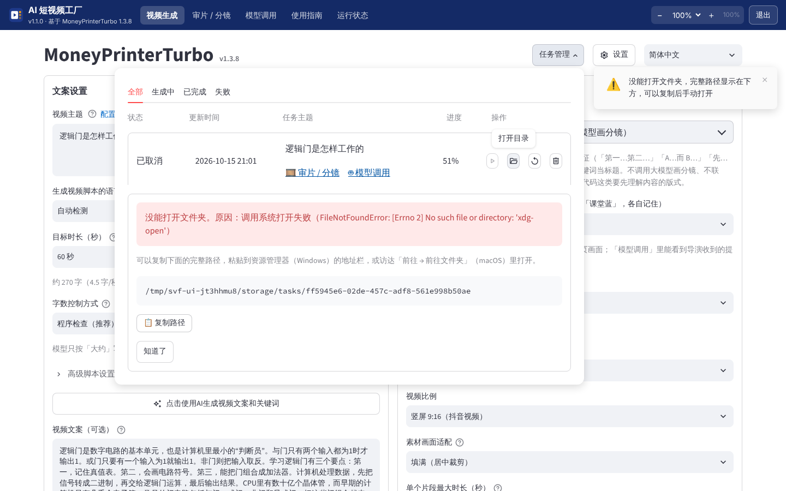

**配音失败的提示怎么来的**（1.0.2）：上游出错时只给一句英文「failed to synthesize audio」，真正的原因只写在日志里。应用会看生成界面后台最近的配音日志，判断是哪一类（403 / No audio was received / 网络），在红色提示后面接上「【原因】……」只说那一条；判断不出来时才列出常见原因，按「声音和文案语言不一致 → 网络或代理 → 403 要升级」的顺序。

**配音失败（403）**：默认的配音服务「Azure TTS V1 (Edge TTS)」用的是微软 Edge 浏览器「大声朗读」的在线接口，不需要 Key，但它不是公开的正式接口，微软改了验证方式后旧版本会被拒绝（返回 403）。2026-10 就发生过一次：1.0.0 随包的 edge-tts 7.2.7 全部 403，edge-tts 7.3.0 起改用新的 Sec-MS-GEC v2 令牌，1.0.1 随包 7.3.1。配音失败时界面上的红色提示会附一段中文原因说明（这是 1.0.1 外壳补的，上游原文只有一句英文）。按顺序检查：

1. 看界面顶栏左侧的版本号，不是最新版就到 [Releases 页面](https://github.com/luoxuran1982/claude2/releases) 下载新版覆盖安装（设置和视频都在数据目录里，不会丢）。
2. 打开数据目录 `logs/webui.log`，搜 `azure_tts_v1`：是 403 而且已是最新版，说明微软又改了接口、新版 edge-tts 还没跟上，请告诉维护者；是超时或连接错误，多半是网络（公司网络、代理、防火墙、杀毒软件拦截 `speech.platform.bing.com`）。
3. 急用时先绕过：「配音服务」换成其他引擎（硅基流动、Azure TTS V2、MiniMax、ElevenLabs、Gemini 等，需要各自的 API Key），或「配音方式」选「上传音频」用自己录的音。

**可选组件（Whisper 字幕）**：上游的字幕还可以用 faster-whisper 识别配音生成（「设置」里把字幕方式改成 whisper）。它要额外约 200 MB 程序和 3 GB 模型，安装包默认不带。确实需要时（开发者操作）：用安装包里的 Python 把它装进数据目录的 `python-packages/`，应用启动时会自动加载：

```
# macOS
"/Applications/AI 短视频工厂.app/Contents/Resources/payload/runtime/bin/python3" -m pip install --target ~/Library/Application\ Support/ShortVideoFactory/python-packages faster-whisper==1.1.0 "av<19"
# Windows（PowerShell）
& "$env:LOCALAPPDATA\Programs\ShortVideoFactory\payload\runtime\python.exe" -m pip install --target "$env:LOCALAPPDATA\ShortVideoFactory\python-packages" faster-whisper==1.1.0 "av<19"
```

默认的 edge 字幕方式不需要它，大多数人用不到。

### 版权与合规

- 视频素材：Pexels / Pixabay 许可允许免费商用，但素材里的人物肖像、商标、建筑等仍可能涉及他人权利；不要用于误导性内容。
- 背景音乐：只放你有权使用的音乐。上游自带的音乐来源不明，本应用不提供。
- 字体：随应用提供的思源黑体、Be Vietnam Pro、Charm 是 SIL OFL 开源字体，可商用。自己复制进 `fonts/` 的系统字体（微软雅黑、苹方等）受各自系统授权约束，商用前请确认。
- 平台规则：抖音、视频号等要求标注 AI 生成内容；批量、矩阵化发布可能被限流或处罚。本应用不替你判断合规。

## 6. 软件框架、系统架构与源码

一句话：窗口里显示的是我们的「外壳」页面，外壳在本机启动上游 MoneyPrinterTurbo 的 Streamlit 界面作为后台进程，并通过本机反向代理把它嵌进窗口。

```
AI 短视频工厂（启动器进程：窗口 + 本机服务 127.0.0.1:随机端口）
├─ 顶栏、审片 / 分镜、模型调用、使用指南、运行状态（外壳页面；审片和模型调用只读任务文件夹里的文件）
├─ /app/ 反向代理 ──► 生成界面后台（随包 Python 运行 Streamlit + MoneyPrinterTurbo，127.0.0.1:另一个随机端口）
│                       ├─ 大模型 API（文案、关键词）   ─ 网络
│                       ├─ Pixabay / Pexels（素材）     ─ 网络（可走「素材下载代理」）
│                       ├─ 外壳扩展 svf_ext（知识讲解卡片：规则切分 / AI 导演 / 工坊主题 / AI 插图、分镜图、快速通道、
│                       │   日志解读、大模型调用记录、字数控制、取消、中文提示）─ 本机（AI 导演调用大模型、插图调用文生图走网络）
│                       ├─ 「打开目录」──► 经本机 HTTP 请启动器打开（/api/open-path）
│                       ├─ Edge TTS（配音、字幕时间戳） ─ 网络
│                       └─ FFmpeg 子进程（MoviePy 剪辑、合成）
└─ 数据目录（config.toml、storage/、fonts/、songs/、logs/）
```

详细的架构、调用链和各模块职责见 [02 软件框架与系统架构](<02 软件框架与系统架构.md>)；手写文件清单、阅读路线、修改与重建方法见 [03 源码阅读与重建指南](<03 源码阅读与重建指南.md>)。应用内「使用指南 → 源码清单与只读查看」可以逐个查看外壳和上游的源码（带行号），「下载全部源码（zip）」打包外壳源码、上游主要源码和全部文档。

## 7. 当前进程与内存（运行状态页）

顶栏「运行状态」显示本次启动涉及的每个进程，每 3 秒自动刷新（可取消勾选，或点「立即刷新」）：

| 列 | 含义 |
| --- | --- |
| 职责 | 启动器（窗口 + 本机服务 + 反向代理）、生成界面后台（Streamlit + MoneyPrinterTurbo）、FFmpeg（生成视频时才有）、WebView2 子进程（仅 Windows） |
| 进程名 / PID / 父 PID | 当前真实值，每次刷新重新读取；已结束的进程不会留在列表里 |
| 内存（MiB） | macOS 用常驻内存 RSS，Windows 用工作集（Working Set），1 MiB = 1024² 字节；读不到时显示「暂不可用」，不拿旧值顶替 |
| 合计 | 各进程数值直接相加，进程间共享的内存（系统库等）可能被重复计算 |

另外列出主进程里的线程（如 shell-server、webui-ready），它们和主进程共用一个 PID，不是独立进程。应用外部的独立依赖（大模型、素材站、Edge TTS 等云端服务；你自己装的 Ollama 等）单独说明，不计入合计。

平台差别：

- **macOS**：窗口网页内容由系统的 WebKit 进程渲染（活动监视器里名为「AI 短视频工厂 网页内容」或 com.apple.WebKit.*），它们不是本应用的子进程，这里显示「暂不可用」。活动监视器「内存」列不是 RSS，数值会和这里不同；可在活动监视器里右键列标题加「实际内存」对照。
- **Windows**：WebView2 会启动几个 msedgewebview2.exe 子进程，逐个列出。任务管理器「详细信息」默认显示「内存（专用工作集）」，比这里的工作集小，这是口径不同，不是读错；可在列标题上右键「选择列」加上「工作集（内存）」对照。

典型数值（参考，容器内 Linux 实测）：空闲时启动器约 35 MiB，生成界面后台载入页面后约 190 MiB（Windows 另有几个 WebView2 进程），生成视频时后台和 FFmpeg 会涨到 1–2 GiB。

## 8. 怎样缩放界面

缩放控件在**窗口顶栏右侧**，「退出」按钮左边，是一组紧凑的按钮：

```
[ − ]  [ 100% ▾ ]  [ ＋ ]  [ 100% ]
```

- **选择具体百分比**：点中间的百分比下拉，选 70%、75%、80%、85%、90%、95%、100%、105%、110%、115%、120% 共 11 档之一。
- **逐档调整**：点「−」每次减 5 个百分点，点「＋」每次加 5 个百分点。到 70% 时「−」变灰不可点，到 120% 时「＋」变灰不可点。下拉框和按钮始终显示同一个当前值。
- **恢复 100%**：点最右边的「100%」按钮（已经是 100% 时它是灰的）。
- **快捷键**：⌘/Ctrl + `=` 放大一档，⌘/Ctrl + `-` 缩小一档，⌘/Ctrl + `0` 恢复 100%（焦点在生成界面里时也有效）。
- 缩放作用于整个界面：顶栏、使用指南、运行状态，以及嵌在里面的 MoneyPrinterTurbo 生成界面（文字、按钮、输入框、表格、下拉菜单都跟着变）。生成界面里少数按像素定死的元素（下拉列表的行高、滑块的轨道）不跟着变。
- 档位保存在数据目录的 `shell.json`，切换栏目、重新打开应用后保留。
- 系统显示缩放（Windows 的 125%、150%，macOS 的「更大字体」）照常生效，两者叠加。窗口太窄时顶栏会自动换行，缩放控件仍然可用。


