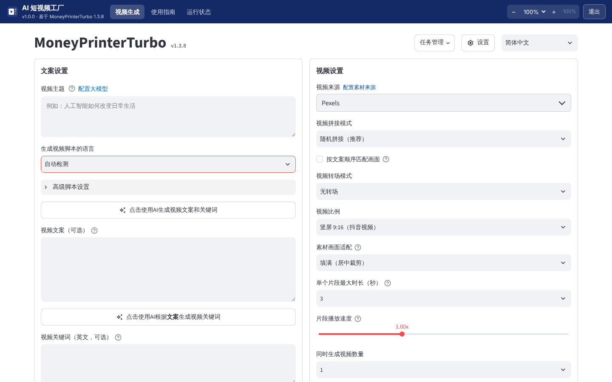
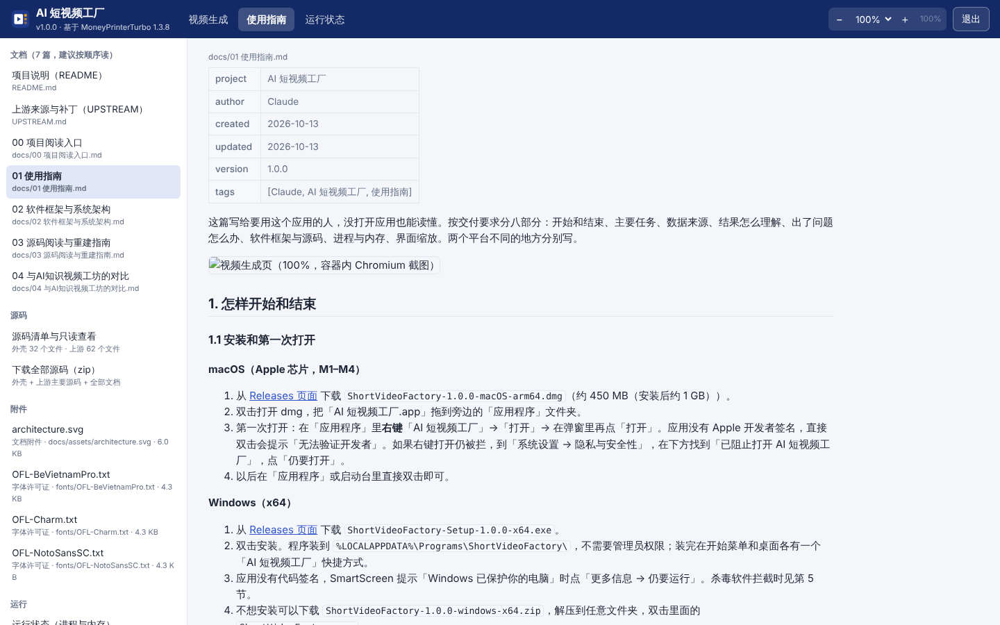
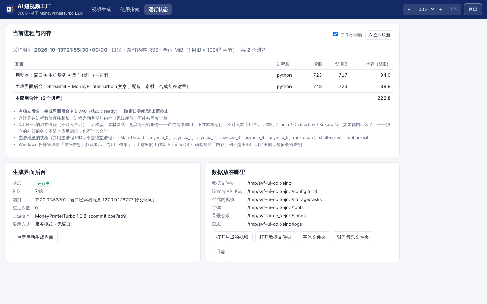

这篇写给要用这个应用的人，没打开应用也能读懂。按交付要求分八部分：开始和结束、主要任务、数据来源、结果怎么理解、出了问题怎么办、软件框架与源码、进程与内存、界面缩放。两个平台不同的地方分别写。



## 1. 怎样开始和结束

### 1.1 安装和第一次打开

**macOS（Apple 芯片，M1–M4）**

1. 从 [Releases 页面](https://github.com/luoxuran1982/claude2/releases) 下载 `ShortVideoFactory-1.0.0-macOS-arm64.dmg`（约 450 MB（安装后约 1 GB））。
2. 双击打开 dmg，把「AI 短视频工厂.app」拖到旁边的「应用程序」文件夹。
3. 第一次打开：在「应用程序」里**右键**「AI 短视频工厂」→「打开」→ 在弹窗里再点「打开」。应用没有 Apple 开发者签名，直接双击会提示「无法验证开发者」。如果右键打开仍被拦，到「系统设置 → 隐私与安全性」，在下方找到「已阻止打开 AI 短视频工厂」，点「仍要打开」。
4. 以后在「应用程序」或启动台里直接双击即可。

**Windows（x64）**

1. 从 [Releases 页面](https://github.com/luoxuran1982/claude2/releases) 下载 `ShortVideoFactory-Setup-1.0.0-x64.exe`。
2. 双击安装。程序装到 `%LOCALAPPDATA%\Programs\ShortVideoFactory\`，不需要管理员权限；装完在开始菜单和桌面各有一个「AI 短视频工厂」快捷方式。
3. 应用没有代码签名，SmartScreen 提示「Windows 已保护你的电脑」时点「更多信息 → 仍要运行」。杀毒软件拦截时见第 5 节。
4. 不想安装可以下载 `ShortVideoFactory-1.0.0-windows-x64.zip`，解压到任意文件夹，双击里面的 `ShortVideoFactory.exe`。
5. 窗口用的是系统自带的 Microsoft Edge WebView2。Windows 10/11 一般都已装好；极少数精简系统没有时，应用会自动改用默认浏览器打开同样的界面（原因写在日志里）。

**打开后**：先出现带顶栏的窗口，「视频生成」页显示「正在启动生成界面…」。第一次启动要加载视频处理组件，一般 10–40 秒（慢的电脑可能 1–2 分钟），之后出现 MoneyPrinterTurbo 的界面。第一次还会弹出 3 步的新手引导（上游自带），可以跟着点，也可以点 × 关掉。

### 1.2 第一次要准备的三样东西

| 东西 | 必需吗 | 费用 | 在哪填 |
| --- | --- | --- | --- |
| 大模型 API Key | 让 AI 写文案时必需；自己写好文案和关键词可以不填 | 按量付费，一条视频几分钱以内（见第 4 节） | 生成界面右上角「设置 → 大模型设置」 |
| Pexels API Key（或 Pixabay） | 用网络素材时必需 | 免费 | 「设置 → 素材来源设置」 |
| 背景音乐 mp3 | 可选 | 看来源 | 放进数据目录的 `songs/` 文件夹 |

**申请 Pexels 免费 Key（约 3 分钟）**

1. 打开 <https://www.pexels.com/api/>，点「Get Started」或「Your API Key」，用邮箱注册或登录 Pexels 账号。
2. 按页面要求填写用途（例如「个人短视频创作，调用视频搜索接口」）和网站（没有可填个人主页或社交账号），勾选同意条款后提交。
3. 页面会显示一串 API Key，复制下来。
4. 回到应用：「视频生成」页右上角「设置」→「素材来源设置」→ 粘贴到「Pexels API Key」（可以填多个，用英文逗号分隔，轮流使用）。
5. 主界面「视频来源」保持「Pexels」。

Pexels 的免费额度是每小时 200 次、每月 2 万次请求（以 Pexels 官网为准），做短视频绰绰有余。素材按 [Pexels 许可](https://www.pexels.com/license/) 可免费商用、不必署名，但不能把素材原样转卖，也不能让画面里可识别的人显得在为某个产品背书。备选的 Pixabay：登录 <https://pixabay.com/api/docs/>，页面「Parameters」一节里直接显示你的 Key，填到「Pixabay API Key」，主界面「视频来源」改成 Pixabay。

**填大模型 Key**

1. 「设置」→「大模型设置」→「大模型提供商」下拉里选一家。国内常用：DeepSeek（Key 在 <https://platform.deepseek.com/api_keys>）、阿里云通义千问（<https://dashscope.console.aliyun.com/apiKey>）、Kimi / Moonshot（默认选中）、火山引擎豆包、智谱等；也支持任何 OpenAI 兼容接口，以及本机的 Ollama（不需要 Key）。
2. 填「API Key」；「接口地址（Base URL）」和「模型名称」留空就用右侧说明里写的默认值，想换模型就按服务商控制台里的模型名填写。
3. 点「测试模型连接」，看到成功提示即可。

右侧说明框和部分链接是上游作者的推广链接（例如「MoneyPrinterTurbo 专属链接」），用不用随你，直接去服务商官网注册效果一样。所有 Key 只保存在你电脑上数据目录的 `config.toml` 里（见第 3 节），不会上传到任何地方，也不在仓库里。

### 1.3 关闭、退出和最小化

| 操作 | macOS | Windows | 结果 |
| --- | --- | --- | --- |
| 退出应用 | ⌘Q、菜单「AI 短视频工厂 → 退出」、程序坞图标右键「退出」、顶栏右侧「退出」按钮 | Alt+F4、任务栏图标右键「关闭窗口」、顶栏右侧「退出」按钮 | 应用退出：先停止生成界面后台（Streamlit）和它启动的 FFmpeg 等子进程，确认都已结束、端口释放，再关闭窗口 |
| 关闭窗口 | 点左上角红色按钮 | 点右上角 × | 本应用只有一个窗口，关掉它就等于退出，结果同上 |
| 最小化 / 隐藏 / 切到别的应用 | 黄色按钮、⌘H、⌘Tab | 最小化按钮、Alt+Tab | 应用和后台**继续运行**，正在生成的视频不受影响 |

注意：退出会**中断正在生成的视频**（顶栏「退出」按钮会先弹窗确认）。已经生成的视频、你的设置和 Key 都保留。

没有任何「关窗后继续在后台运行」的功能，也没有系统托盘常驻。万一应用崩溃或被强制结束来不及收尾，生成界面后台每 2 秒检查一次启动器还在不在，不在就自行结束（连同 FFmpeg）；Windows 上系统还会通过「作业对象」直接结束它；下次启动时也会检查并清理上次遗留的后台。

再次双击图标时如果应用已经在运行，会把已有窗口调到前面，不会开第二份。

## 2. 怎样完成主要任务（出一条视频）

窗口顶栏有三个栏目：**视频生成**（上游 MoneyPrinterTurbo 的界面）、**使用指南**（本文档和全部资料）、**运行状态**（进程与内存）。右侧是缩放控件和「退出」。

### 2.1 最常用的顺序

1. **视频主题**：在「文案设置 → 视频主题」写一句话，例如「为什么夏天容易犯困」。「生成视频脚本的语言」保持「自动检测」或选 zh-CN。
2. **生成文案和关键词**：点「点击使用AI生成视频文案和关键词」。大模型先写文案（填进「视频文案」），再生成 5 个英文素材搜索词（填进「视频关键词」）。两处都可以手动改；自己写文案的话直接粘贴，再点「点击使用AI根据文案生成视频关键词」。
3. **视频设置**（右上）：「视频来源」Pexels；「视频比例」竖屏 9:16（抖音/视频号）或横屏 16:9；「视频拼接模式」随机拼接；「单个片段最大时长」默认 3 秒；「同时生成视频数量」默认 1。
4. **音频设置**（左下）：「配音方式」自动配音；「配音服务」默认「Azure TTS V1 (Edge TTS)」（免费，需联网）；「配音声音」选一个中文声音（如 zh-CN 开头的），点「试听音色」；「背景音乐来源」默认随机（`songs/` 里没有 mp3 时不加背景音乐）。
5. **字幕设置**（右下）：默认启用，字体是随应用提供的「NotoSansSC-Bold.ttf」（思源黑体粗体），可调位置、颜色、大小、描边。
6. 点页面最下方红色的「**生成视频**」。下方会显示进度和日志：生成文案 → 关键词 → 配音 → 字幕 → 下载素材 → 合成。一条 1 分钟左右的视频，在普通电脑上一般 2–6 分钟，主要花在下载素材和编码。
7. 完成后页面里直接播放成片，同时自动打开任务文件夹（可在「设置 → 界面设置」关掉）。

### 2.2 各处按钮的作用

| 位置 | 按钮 / 选项 | 作用 |
| --- | --- | --- |
| 生成界面右上 | 任务管理 | 查看历史任务、打开任务文件夹、删除任务 |
| 生成界面右上 | 设置 | 大模型、素材来源、自动发布（Upload-Post，可选）、界面、密钥备份、缓存管理 |
| 生成界面右上 | Language / 语言 | 界面语言，默认简体中文 |
| 文案设置 | 高级脚本设置 | 段落数、附加要求、自定义系统提示词 |
| 音频设置 | 上传音频 / 无配音 | 用自己录的配音，或只出画面+字幕 |
| 底部 | 设置预设 | 保存/载入整套参数 |
| 外壳顶栏 | 运行状态 → 打开生成的视频 / 数据文件夹 / 字体文件夹 / 背景音乐文件夹 / 日志 | 在访达或资源管理器里打开对应文件夹 |
| 外壳顶栏 | 运行状态 → 重新启动生成界面 | 生成界面卡住或出错时重启后台（会中断正在生成的视频） |

「视频来源」里还有 AI 视频（秘塔/MiniMax、OFox、即梦、火山 Seedance 等）和 AI 生图，都是上游接入的**付费**服务，需要各自的 Key，按秒或按条计费，价格在界面上有标注。本应用默认不用它们。

### 2.3 结果在哪

- 每个任务一个文件夹：数据目录 `storage/tasks/<任务编号>/`，里面有 `final-1.mp4`（成片）、`combined-1.mp4`（无字幕拼接版）、`audio.mp3`（配音）、`subtitle.srt`（字幕）、`script.json`（文案和关键词）。
- 「运行状态」页的「打开生成的视频」直接打开 `storage/tasks/`。

## 3. 数据从哪来、存在哪、何时更新

| 数据 | 来源 | 何时产生 / 更新 | 存在哪 |
| --- | --- | --- | --- |
| 文案、关键词 | 你选的大模型 | 点「生成文案和关键词」或「生成视频」时，各调用 1 次 | 任务文件夹 `script.json` |
| 视频素材 | Pexels / Pixabay / Coverr 按英文关键词搜索后下载 | 生成视频时 | 素材缓存 `storage/cache_videos/`（下次同样关键词可复用，「设置 → 缓存管理」可清理） |
| 配音 | Edge TTS（微软在线语音，免费）或你配置的其他 TTS | 生成视频时 | 任务文件夹 `audio.mp3` |
| 字幕时间轴 | 默认用 Edge TTS 返回的逐词时间戳 | 生成视频时 | 任务文件夹 `subtitle.srt` |
| 背景音乐 | 你放进 `songs/` 的 mp3 | 生成时随机挑一首（或指定） | `songs/` |
| 设置与 API Key | 你在界面里填写 | 改动后立即保存 | `config.toml` |

数据目录：macOS `~/Library/Application Support/ShortVideoFactory/`，Windows `%LOCALAPPDATA%\ShortVideoFactory\`。里面：

```
config.toml        上游的设置文件（大模型、素材、配音的 Key 都在这里，请勿外传）
storage/tasks/     生成的视频（每个任务一个文件夹）
storage/cache_*    素材搜索与下载缓存
fonts/             字幕字体（随应用提供的开源字体 + 你自己放的字体）
songs/             背景音乐（你自己放）
logs/              launcher.log（外壳）、webui.log（生成界面后台）
shell.json         外壳设置（缩放档位、上次打开的栏目）
webview/           窗口的浏览器缓存
```

数据目录不在安装目录里，升级、重装、卸载都不会删。想彻底清除，退出应用后手动删除这个文件夹。

## 4. 结果怎么理解

**一条视频花多少钱**：大模型默认调用 **2 次**（文案 1 次 + 搜索关键词 1 次，失败会自动重试最多 5 次）。一条 1 分钟视频的文案约 300–400 字，两次调用合计大约 1500–3000 token，用 DeepSeek、通义千问这类国内模型通常不到 1 分钱，用 GPT / Claude 级别的模型也就几分钱。Pexels、Pixabay、Edge TTS 免费。界面上不显示花费，以服务商控制台的账单为准。如果开了「自动发布」（Upload-Post），每次发布还会多 1 次调用生成标题和标签。

**画面和文字的关系**：画面是按英文关键词从素材库里搜来的实拍片段，和文案只在「主题词」层面相关，不是逐句对应；可能出现画面和这句话说的事对不上、同一个片段风格不统一、外国面孔和场景居多的情况。勾选「按文案顺序匹配画面」会让关键词按文案顺序生成、素材按顺序拼接，对得更准一些。数字、公式、图表、代码、人名这类内容**画不出来**——素材库里没有，这类题材见 [04 对比](<04 与AI知识视频工坊的对比.md>)。

**文案准确性**：文案完全由大模型根据主题写成，没有参考资料输入、没有事实核对环节，可能有事实错误或过时信息，发布前请自己核对。

**配音和字幕**：Edge TTS 的中文声音自然度不错；字幕按逐词时间戳断句，和配音同步。多音字、英文缩写可能读错，可在文案里改写（如把「GPU」写成「G P U」）。

**已知限制和没验证的**：

- 本应用在 Linux 容器里验证了界面、接口和进程管理；**没有用真实 Key 跑通出片**（容器里没有 Key），真实出片待你在电脑上验收。
- Whisper 字幕模式需要额外组件，默认不提供（见第 5 节「可选组件」）。
- Edge TTS 是微软的在线服务，非官方接口，可能限流或变动；商用授权没有明确说法。
- 「自动发布」（Upload-Post）是上游功能，本应用没有验证；各平台对自动化发布有限制，请谨慎使用。

## 5. 出了问题怎么办

先看「运行状态」页：生成界面后台的状态、错误信息；再看数据目录 `logs/` 里的 `webui.log`（生成过程的详细日志）和 `launcher.log`（窗口和后台的启停）。

| 现象 | 可能原因 | 怎么办 |
| --- | --- | --- |
| 一直显示「正在启动生成界面」超过 2 分钟 | 电脑慢、杀毒软件在扫描大量文件 | 等一会儿；仍不行点「重新启动生成界面」，再看 `webui.log` |
| 显示「生成界面没能启动」 | 随包 Python 被拦截、文件损坏 | 看页面上的日志末尾；Windows 检查杀毒软件隔离区，把安装目录加白名单后重装；macOS 见下一行 |
| macOS 提示「无法验证开发者」或「已损坏」 | 没有签名 + 下载隔离标记 | 右键 →「打开」；仍不行在「终端」执行 `xattr -cr "/Applications/AI 短视频工厂.app"` 后再打开（这是一次性操作） |
| Windows SmartScreen / 杀毒软件拦截 | 没有代码签名，应用会启动 Python 和 FFmpeg 子进程 | 「更多信息 → 仍要运行」；把 `%LOCALAPPDATA%\Programs\ShortVideoFactory` 加入信任 |
| 窗口是空白的或打不开，改成了浏览器 | Windows 缺 WebView2 运行时 | 到微软官网安装「Microsoft Edge WebView2 Runtime」；浏览器模式功能相同，关闭页面 3 分钟后应用自动退出 |
| 生成文案失败 / 测试连接失败 | Key 错、余额不足、模型名不对、网络 | 「设置 → 大模型设置」重新测试；看 `webui.log` 里服务商返回的错误 |
| 「请先填写 Pexels API Key」或素材下载失败 | 没填 Key、Key 失效、网络连不上 Pexels | 填 Key；Pexels 在部分网络环境下访问慢，可在「设置」里配置代理，或改用 Pixabay |
| 配音失败 | Edge TTS 需要联网，偶尔限流 | 稍后重试，或换一个声音/配音服务 |
| 字幕方框乱码 | 选了不含中文的字体（BeVietnamPro、Charm） | 字幕字体选 `NotoSansSC-Bold.ttf`，或点「恢复默认字幕设置」 |
| 没有背景音乐 | `songs/` 是空的 | 把 mp3 放进 `songs/`（「运行状态 → 背景音乐文件夹」） |
| 生成的视频找不到 | — | 「运行状态 → 打开生成的视频」，或「任务管理」 |
| 退出后担心有进程残留 | — | macOS「活动监视器」/ Windows「任务管理器 → 详细信息」搜 ShortVideoFactory、python、ffmpeg；正常退出后都应消失 |

**可选组件（Whisper 字幕）**：上游的字幕还可以用 faster-whisper 识别配音生成（「设置」里把字幕方式改成 whisper）。它要额外约 200 MB 程序和 3 GB 模型，安装包默认不带。确实需要时（开发者操作）：用安装包里的 Python 把它装进数据目录的 `python-packages/`，应用启动时会自动加载：

```
# macOS
"/Applications/AI 短视频工厂.app/Contents/Resources/payload/runtime/bin/python3" -m pip install --target ~/Library/Application\ Support/ShortVideoFactory/python-packages faster-whisper==1.1.0 "av<19"
# Windows（PowerShell）
& "$env:LOCALAPPDATA\Programs\ShortVideoFactory\payload\runtime\python.exe" -m pip install --target "$env:LOCALAPPDATA\ShortVideoFactory\python-packages" faster-whisper==1.1.0 "av<19"
```

默认的 edge 字幕方式不需要它，大多数人用不到。

### 版权与合规

- 视频素材：Pexels / Pixabay 许可允许免费商用，但素材里的人物肖像、商标、建筑等仍可能涉及他人权利；不要用于误导性内容。
- 背景音乐：只放你有权使用的音乐。上游自带的音乐来源不明，本应用不提供。
- 字体：随应用提供的思源黑体、Be Vietnam Pro、Charm 是 SIL OFL 开源字体，可商用。自己复制进 `fonts/` 的系统字体（微软雅黑、苹方等）受各自系统授权约束，商用前请确认。
- 平台规则：抖音、视频号等要求标注 AI 生成内容；批量、矩阵化发布可能被限流或处罚。本应用不替你判断合规。

## 6. 软件框架、系统架构与源码

一句话：窗口里显示的是我们的「外壳」页面，外壳在本机启动上游 MoneyPrinterTurbo 的 Streamlit 界面作为后台进程，并通过本机反向代理把它嵌进窗口。

```
AI 短视频工厂（启动器进程：窗口 + 本机服务 127.0.0.1:随机端口）
├─ 顶栏、使用指南、运行状态（外壳页面）
├─ /app/ 反向代理 ──► 生成界面后台（随包 Python 运行 Streamlit + MoneyPrinterTurbo，127.0.0.1:另一个随机端口）
│                       ├─ 大模型 API（文案、关键词）   ─ 网络
│                       ├─ Pexels / Pixabay（素材）     ─ 网络
│                       ├─ Edge TTS（配音、字幕时间戳） ─ 网络
│                       └─ FFmpeg 子进程（MoviePy 剪辑、合成）
└─ 数据目录（config.toml、storage/、fonts/、songs/、logs/）
```

详细的架构、调用链和各模块职责见 [02 软件框架与系统架构](<02 软件框架与系统架构.md>)；手写文件清单、阅读路线、修改与重建方法见 [03 源码阅读与重建指南](<03 源码阅读与重建指南.md>)。应用内「使用指南 → 源码清单与只读查看」可以逐个查看外壳和上游的源码（带行号），「下载全部源码（zip）」打包外壳源码、上游主要源码和全部文档。

## 7. 当前进程与内存（运行状态页）

顶栏「运行状态」显示本次启动涉及的每个进程，每 3 秒自动刷新（可取消勾选，或点「立即刷新」）：

| 列 | 含义 |
| --- | --- |
| 职责 | 启动器（窗口 + 本机服务 + 反向代理）、生成界面后台（Streamlit + MoneyPrinterTurbo）、FFmpeg（生成视频时才有）、WebView2 子进程（仅 Windows） |
| 进程名 / PID / 父 PID | 当前真实值，每次刷新重新读取；已结束的进程不会留在列表里 |
| 内存（MiB） | macOS 用常驻内存 RSS，Windows 用工作集（Working Set），1 MiB = 1024² 字节；读不到时显示「暂不可用」，不拿旧值顶替 |
| 合计 | 各进程数值直接相加，进程间共享的内存（系统库等）可能被重复计算 |

另外列出主进程里的线程（如 shell-server、webui-ready），它们和主进程共用一个 PID，不是独立进程。应用外部的独立依赖（大模型、素材站、Edge TTS 等云端服务；你自己装的 Ollama 等）单独说明，不计入合计。

平台差别：

- **macOS**：窗口网页内容由系统的 WebKit 进程渲染（活动监视器里名为「AI 短视频工厂 网页内容」或 com.apple.WebKit.*），它们不是本应用的子进程，这里显示「暂不可用」。活动监视器「内存」列不是 RSS，数值会和这里不同；可在活动监视器里右键列标题加「实际内存」对照。
- **Windows**：WebView2 会启动几个 msedgewebview2.exe 子进程，逐个列出。任务管理器「详细信息」默认显示「内存（专用工作集）」，比这里的工作集小，这是口径不同，不是读错；可在列标题上右键「选择列」加上「工作集（内存）」对照。

典型数值（参考，容器内 Linux 实测）：空闲时启动器约 35 MiB，生成界面后台载入页面后约 190 MiB（Windows 另有几个 WebView2 进程），生成视频时后台和 FFmpeg 会涨到 1–2 GiB。

## 8. 怎样缩放界面

缩放控件在**窗口顶栏右侧**，「退出」按钮左边，是一组紧凑的按钮：

```
[ − ]  [ 100% ▾ ]  [ ＋ ]  [ 100% ]
```

- **选择具体百分比**：点中间的百分比下拉，选 70%、75%、80%、85%、90%、95%、100%、105%、110%、115%、120% 共 11 档之一。
- **逐档调整**：点「−」每次减 5 个百分点，点「＋」每次加 5 个百分点。到 70% 时「−」变灰不可点，到 120% 时「＋」变灰不可点。下拉框和按钮始终显示同一个当前值。
- **恢复 100%**：点最右边的「100%」按钮（已经是 100% 时它是灰的）。
- **快捷键**：⌘/Ctrl + `=` 放大一档，⌘/Ctrl + `-` 缩小一档，⌘/Ctrl + `0` 恢复 100%（焦点在生成界面里时也有效）。
- 缩放作用于整个界面：顶栏、使用指南、运行状态，以及嵌在里面的 MoneyPrinterTurbo 生成界面（文字、按钮、输入框、表格、下拉菜单都跟着变）。生成界面里少数按像素定死的元素（下拉列表的行高、滑块的轨道）不跟着变。
- 档位保存在数据目录的 `shell.json`，切换栏目、重新打开应用后保留。
- 系统显示缩放（Windows 的 125%、150%，macOS 的「更大字体」）照常生效，两者叠加。窗口太窄时顶栏会自动换行，缩放控件仍然可用。




