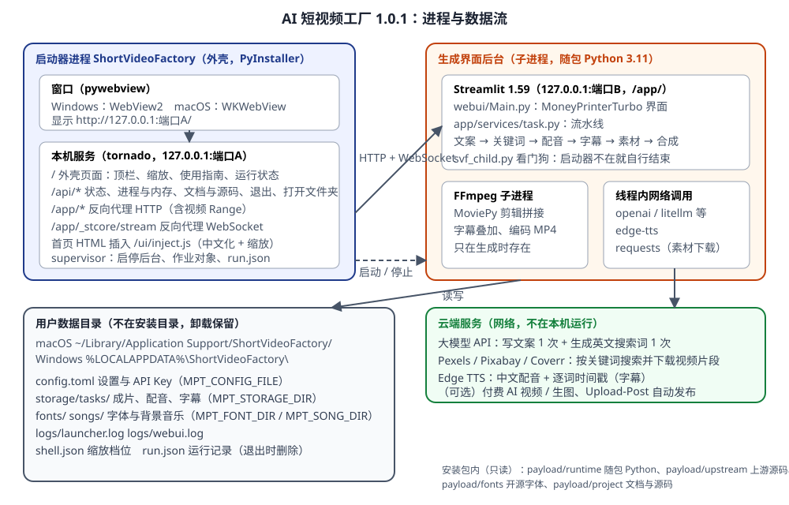

## 软件要解决什么问题

MoneyPrinterTurbo 本身是一个 Python 项目：用 Streamlit 写的网页界面（WebUI）加一套 FastAPI 接口，平时要装 Python、装依赖、在命令行运行 `webui.sh` / `webui.bat`，再用浏览器打开。AI 短视频工厂做三件事：

1. **变成双击就能用的桌面应用**：自带 Python 运行时、全部依赖和 FFmpeg，在独立窗口里显示，不需要终端、不需要另装任何东西。
2. **按交付要求补齐**：版本号、应用内「使用指南」（完整文档 + 源码只读查看 + 源码 zip）、运行状态（逐进程 PID / 内存）、70%–120% 界面缩放、关窗即停止全部后台、数据放用户数据目录、全中文。
3. **尽量不改上游**：上游只打了 4 处小补丁（见 [UPSTREAM.md](<../UPSTREAM.md>)），以后可以跟着上游升级。



## 两层结构：外壳 + 上游

| 层 | 代码 | 运行在哪 | 职责 |
| --- | --- | --- | --- |
| 外壳（本项目手写） | `svf/`、`packaging/`、`tests/` | 启动器进程（PyInstaller 打包的 ShortVideoFactory 可执行文件） | 窗口、本机服务、反向代理、启停与监视后台、使用指南、运行状态、缩放、中文化、打包 |
| 上游（MoneyPrinterTurbo） | `upstream/` | 生成界面后台进程（随包 Python 运行 Streamlit） | 文案、关键词、素材、配音、字幕、背景音乐、合成，以及它自己的设置、任务管理界面 |

为什么外壳不直接把 Streamlit 当首页：外壳需要顶栏、使用指南和运行状态，又要能把缩放作用到 Streamlit 页面内部、把 Streamlit 自带的英文提示换成中文。浏览器只允许同源页面互相操作，所以外壳在自己的端口上把 Streamlit **反向代理到 `/app/` 路径下**：窗口里外壳页面和嵌入的 Streamlit 页面同源，外壳在 Streamlit 首页 HTML 里插入一行 `<script src="/ui/inject.js">`，就能做到这些，而上游一行不用改。

## 进程关系

```
ShortVideoFactory（启动器，主进程）
├─ 线程：shell-server（tornado 事件循环：外壳页面、接口、反向代理）
├─ 线程：webui-ready / webui-exit（等后台就绪、发现后台意外退出）
├─ 线程：run-record（后台 PID 变化时更新 run.json）
├─ 子进程（仅 Windows）：msedgewebview2.exe × 若干（WebView2 渲染窗口）
└─ 子进程：生成界面后台 = 随包 python3 svf_child.py → Streamlit（127.0.0.1:随机端口，baseUrlPath=app）
     ├─ 线程：svf-watchdog（每 2 秒检查启动器是否还在）
     ├─ 线程：Streamlit 会话、上游任务线程（一次只跑 1 个生成任务，其余排队）
     └─ 子进程：ffmpeg（MoviePy / pydub 调用，生成视频时才有）
```

macOS 的 WKWebView 网页进程由系统 XPC 服务托管，不是启动器的子进程。

**端口**：启动器的本机服务和 Streamlit 都只监听 `127.0.0.1`，端口都是启动时向系统要的随机空闲端口（命令行 `--port` / `--webui-port` 可指定，测试用）。窗口只访问启动器的端口；Streamlit 的端口只有启动器在用。

**为什么生成界面要单独一个进程**：Streamlit 要求在主线程里运行并接管信号，窗口库（macOS 的 Cocoa）也要求主线程，两者放不进同一个进程；而且上游依赖很重（pandas、pyarrow、MoviePy 等），跑在随包 Python 里能按上游锁定的版本完整安装，避开 Streamlit 被 PyInstaller 打包时丢静态文件和包元数据的老问题。

## 启动和退出的调用链

**启动**（`svf/app.py: Shell.main`）：

1. `setup_logging` → 数据目录 `logs/launcher.log`。
2. `supervisor.cleanup_stale`：读上次的 `run.json`。上次的启动器还活着（PID + 创建时间都对得上）→ 调用它的 `/api/focus` 把窗口调到前面，本次退出；不活着但后台还在 → 结束遗留后台。
3. `clear_quarantine`（仅 macOS 安装版）：去掉随包部件的下载隔离标记。
4. `userdata.prepare`：建 `storage/ fonts/ songs/ logs/`；第一次运行用上游 `config.example.toml` 生成 `config.toml`，界面语言设成中文、默认字幕字体设成随包的思源黑体；复制开源字体。
5. `ServerThread.start`：在后台线程起 tornado（`svf/server.py`），绑定 127.0.0.1 随机端口。
6. `WebUI.start`（`svf/supervisor.py`）：用随包 Python 运行 `svf_child.py`，环境变量 `MPT_CONFIG_FILE / MPT_STORAGE_DIR / MPT_FONT_DIR / MPT_SONG_DIR` 指向数据目录。POSIX 上 `start_new_session=True`（自成进程组），Windows 上 `CREATE_NO_WINDOW` 并放进「关闭即结束」的作业对象。`svf_child.py` 启动 Streamlit 前把 `IMAGEIO_FFMPEG_EXE` 指向随包的 imageio-ffmpeg（不受系统 PATH 里其他版本 FFmpeg 影响；你在上游设置里填了 `ffmpeg_path` 时仍以它为准）。启动器另起线程轮询 `/app/_stcore/health`，就绪后状态变成 ready。
7. 写 `run.json`（启动器和后台的 PID、创建时间、端口、令牌）。
8. `run_window`：pywebview 建窗口，载入 `http://127.0.0.1:端口A/`。外壳页面每秒查一次 `/api/status`，后台 ready 后把 iframe 指向 `/app/`。

**退出**（`Shell.shutdown`，正常退出的所有路径都走这里，只执行一次）：

1. `WebUI.stop`：枚举后台进程树（含 FFmpeg）→ POSIX 整个进程组发 SIGTERM / Windows 逐个结束 → 最多等 6 秒 → 仍在的强制结束 → 用 psutil 逐个确认已退出 → 确认 Streamlit 端口不再监听。
2. `ServerThread.stop`：停 tornado、关闭连接、释放端口 A。
3. 删除 `run.json`（运行记录只是收尾，不删任何用户数据）。日志里记一行「已退出：后台进程 […] 已结束，端口 … 已释放」。

触发退出的方式：关闭窗口（`events.closed`）、macOS ⌘Q 等（`webview.start()` 返回）、顶栏「退出」（`/api/quit` → 销毁窗口）、SIGTERM、浏览器模式下页面 3 分钟无访问。

**异常收尾**（启动器崩溃或被强制结束，来不及执行上面的步骤）：

- 后台里的看门狗线程（`svf/child.py: watchdog`）每 2 秒检查父进程：POSIX 看 `getppid()` 是否变了，Windows 用 `OpenProcess + WaitForSingleObject`。启动器不在了 → 整组结束（含 FFmpeg）后自身退出。
- Windows 上作业对象带 `JOB_OBJECT_LIMIT_KILL_ON_JOB_CLOSE`：启动器进程一结束，系统自动结束作业里的全部进程，不依赖看门狗。
- 下次启动时 `cleanup_stale` 再兜一次底。
- CI 冒烟测试里专门测了这条路径：强制结束启动器后 20 秒内后台和端口都必须消失。

## 上游 MoneyPrinterTurbo 的生成流水线

入口是界面底部「生成视频」→ `app/services/webui_task.py` 把任务交给内存任务管理器（同时只跑 1 个）→ `app/services/task.py: _run_pipeline`：

| 步骤 | 函数 | 做什么 | 外部依赖 |
| --- | --- | --- | --- |
| 1 文案 | `task.generate_script` → `llm.generate_script` | 文案为空时，用固定的英文系统提示词（Role: Video Script Generator）+ 主题、段落数、语言，调用 1 次大模型；失败最多重试 5 次；去掉 Markdown 符号 | 大模型 API |
| 2 关键词 | `task.generate_terms` → `llm.generate_terms` | 让大模型按主题和文案输出 5 个（按文案顺序匹配时 8 个）英文素材搜索词，JSON 数组 | 大模型 API |
| 3 配音 | `task.generate_audio` → `voice.tts` | 默认 Azure TTS V1（即 edge-tts），返回音频和逐词时间（SubMaker）；也支持 Azure V2、硅基流动、MiniMax、ElevenLabs、Gemini 等 | Edge TTS 等 |
| 4 字幕 | `task.generate_subtitle` | 默认 edge：用配音的逐词时间戳按标点切句生成 SRT；可选 whisper：用 faster-whisper 识别配音 | 无 / faster-whisper |
| 5 素材 | `task.get_video_materials` → `material.download_videos` | 逐个关键词调用 Pexels / Pixabay / Coverr 搜索接口，按比例和分辨率筛选，下载片段直到总时长覆盖配音；有本地缓存 | 素材站 API |
| 6 拼接 | `video.combine_videos` | MoviePy 把片段裁成目标比例、按单段最大时长切、随机或顺序拼接、可加转场 | FFmpeg |
| 7 合成 | `video.generate_video` | 叠加字幕（PIL 渲染文字，可描边/背景/入场动画）、混入配音和背景音乐（随机挑 `songs/` 里的 mp3）、编码 H.264 MP4 | FFmpeg |

产物写在 `storage/tasks/<任务编号>/`：`script.json`、`audio.mp3`、`subtitle.srt`、`combined-1.mp4`、`final-1.mp4`。

上游还有：FastAPI 接口（`main.py` → `app/asgi.py`，本应用没有启动它）、命令行 `cli.py`、自动发布（Upload-Post）、一批付费 AI 视频/生图服务的接入（秘塔、OFox、LoomLoom、即梦/火山 Seedance、MuAPI、WaveSpeed、OpenAI 生图）、TwelveLabs 关键词重排等，都在同一套流水线里按配置启用。

## 外壳模块一览

| 文件 | 职责 | 关键函数 / 类 |
| --- | --- | --- |
| `svf/__init__.py` | 应用名、版本、上游版本、默认字体 | `__version__`、`UPSTREAM_COMMIT` |
| `svf/paths.py` | 数据目录；源码运行和安装包里各部件的位置 | `data_dir`、`payload_dir`、`runtime_python`、`guide_root` |
| `svf/app.py` | 启动、窗口、浏览器模式、退出收尾、单实例 | `Shell.main`、`run_window`、`shutdown`、`clear_quarantine` |
| `svf/supervisor.py` | 后台进程的启动、就绪检测、停止与确认、作业对象、运行记录 | `WebUI`、`_WinJob`、`cleanup_stale`、`kill_tree` |
| `svf/child.py` | 后台进程入口（随包 Python 里运行，只用标准库）：看门狗 + 启动 Streamlit | `watchdog`、`parent_alive`、`streamlit_argv` |
| `svf/server.py` | tornado 本机服务：外壳页面与接口、HTTP/WebSocket 反向代理、首页注入 | `ProxyHandler`、`WSProxyHandler`、`make_app`、`ServerThread` |
| `svf/userdata.py` | 首启配置、字体复制、外壳设置（缩放档位） | `initial_config_text`、`prepare`、`ShellSettings`、`clamp_zoom` |
| `svf/procinfo.py` | 运行状态：进程树、职责、内存口径 | `snapshot`、`role_of` |
| `svf/guide.py` | 使用指南：文档、附件、源码白名单与 zip | `list_docs`、`list_sources`、`source_zip` |
| `svf/web/index.html`、`app.js` | 外壳页面：顶栏、栏目、视频生成页、运行状态 | `pollStudio`、`setZoom`、`renderStatus` |
| `svf/web/guide.js`、`md.js` | 使用指南页、Markdown 渲染 | `SVFGuide`、`SVFMarkdown.render` |
| `svf/web/zoom.js` | 缩放档位逻辑（11 档、上下限） | `SVFZoom.step`、`clamp` |
| `svf/web/inject.js`、`inject.css` | 插入 Streamlit 页面：缩放、中文化、外链交给系统浏览器 | `applyZoom`、`tr`、`walk` |

外壳接口（都只接受 127.0.0.1 / localhost 访问；会改状态的接口要带页面里的随机令牌 `X-SVF-Token`）：

| 接口 | 作用 |
| --- | --- |
| `GET /api/status` | 应用版本、窗口模式、后台状态（starting / ready / failed / stopped）、端口、数据路径 |
| `GET /api/processes` | 运行状态页的数据（每次现读） |
| `GET/POST /api/settings` | 缩放档位、上次的栏目和文档 |
| `GET /api/guide`、`/api/guide/doc`、`/api/guide/source`、`/api/guide/file`、`/api/guide/source.zip` | 使用指南的清单、文档、源码、附件、源码包 |
| `POST /api/quit` | 退出（停后台、关窗口） |
| `POST /api/webui/restart` | 重启生成界面后台 |
| `POST /api/open` | 用访达 / 资源管理器打开数据文件夹，或用系统浏览器打开外部网址 |
| `POST /api/focus` | 第二次启动时把已有窗口调到前面 |

## 缩放是怎么实现的

- 外壳页面所有尺寸用 rem，根字号 = 15px × 档位（CSS 变量 `--zoom`）。
- 嵌入的 Streamlit 页面由 `inject.js` 把根字号设为 16px × 档位。Streamlit 的字号、间距、控件高度几乎都用 rem，所以整页跟着缩放。没用 CSS `zoom` 的原因：在容器里实测，CSS zoom 下 Streamlit 下拉菜单的弹出位置会偏开（120% 时偏下约 100 像素，70% 时跑到输入框上方），根字号方式位置正确。
- 档位改变时外壳通过 `postMessage` 通知 iframe；档位存进数据目录的 `shell.json`，下次打开、刷新都保留（窗口端口每次不同，浏览器本地存储会丢，所以存在服务端）。

## 中文化

- 上游界面本身有中文语言包（`webui/i18n/zh.json`），首启时把 `config.toml` 的界面语言设成中文；P4 补丁补齐了 9 个仍是英文的标签。
- Streamlit 框架自带的提示（上传框「Drag and drop file here」「Browse files」「… per file」、下拉框「Choose an option」、密码框、帮助按钮、多选标签的无障碍提示等）上游改不了，由 `inject.js` 用对照表在页面里替换，并用 MutationObserver 处理后来出现的元素。只替换 Streamlit 组件自身的文字，不碰你输入的内容、Markdown 正文和代码。
- 窗口菜单（macOS 的「退出」「隐藏」「编辑」等）和确认对话框通过 pywebview 的 localization 参数设成中文。
- 仍保留英文的：服务商、模型和产品名（Pexels、API Key、Kimi 等），上游给大模型的英文系统提示词（属于内容，改了会影响生成效果），以及日志。

## 数据放在哪

| 内容 | 位置 | 谁写 |
| --- | --- | --- |
| 程序（只读） | macOS `AI 短视频工厂.app/Contents/{MacOS,Frameworks,Resources/payload}`；Windows `%LOCALAPPDATA%\Programs\ShortVideoFactory\{ShortVideoFactory.exe,_internal,payload}` | 安装程序 |
| 上游设置与 API Key | 数据目录 `config.toml` | 上游（P1 补丁） |
| 生成的视频、缓存 | 数据目录 `storage/` | 上游（P2 补丁） |
| 字体、背景音乐 | 数据目录 `fonts/`、`songs/` | 外壳首启复制开源字体；用户自己放 |
| 外壳设置 | 数据目录 `shell.json` | 外壳 |
| 运行记录 | 数据目录 `run.json`（退出时删除） | 外壳 |
| 日志 | 数据目录 `logs/launcher.log`（外壳，1 MB 轮转 3 份）、`logs/webui.log`（后台输出，超过 5 MB 时改名为 webui.old.log） | 外壳、上游 |
| 窗口缓存 | 数据目录 `webview/` | pywebview |

## 打包后的目录

```
payload/                      （Windows 在安装目录下；macOS 在 .app/Contents/Resources/ 下）
  runtime/    python-build-standalone 3.11 + requirements-runtime.txt 里的依赖（.pyc 已预编译）
  upstream/   MoneyPrinterTurbo（去掉了测试、Docker、文档图片、商业字体、音乐）
  fonts/      NotoSansSC-Bold.ttf 与 OFL 许可证
  child/      svf_child.py
  project/    README、UPSTREAM、docs/、外壳源码、上游主要源码（给「使用指南」离线显示）
```

详细的构建步骤见 [03 源码阅读与重建指南](<03 源码阅读与重建指南.md>)。
